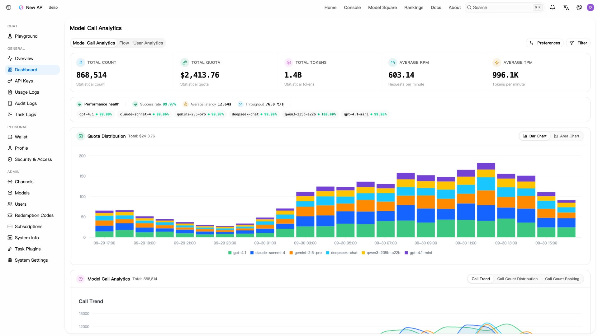
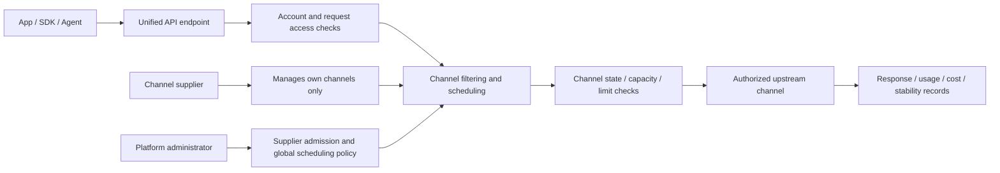
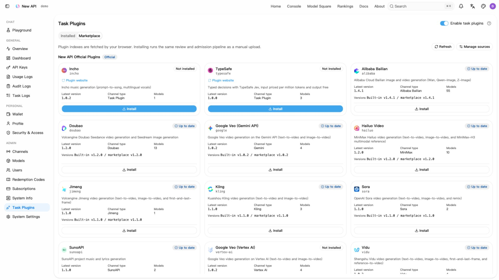
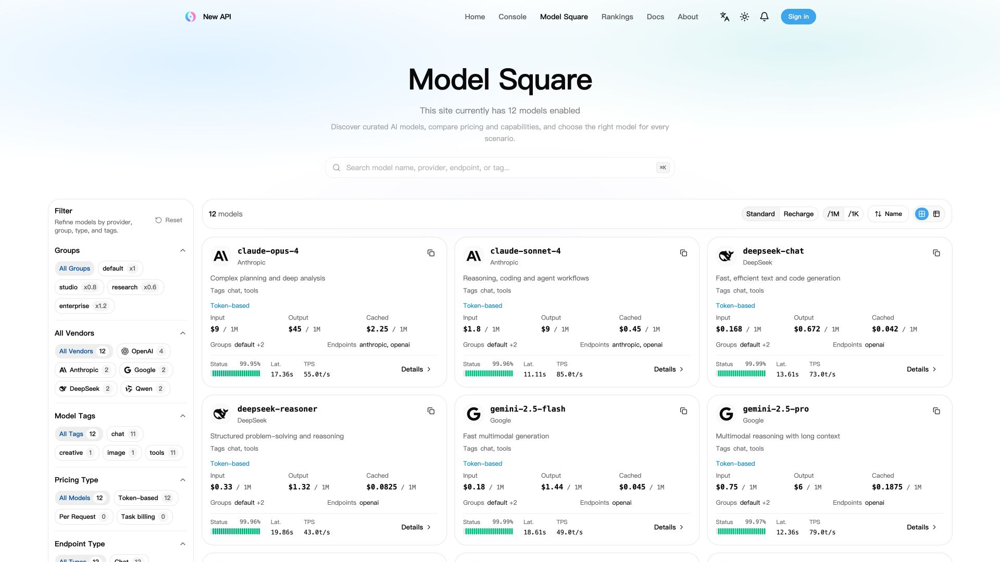
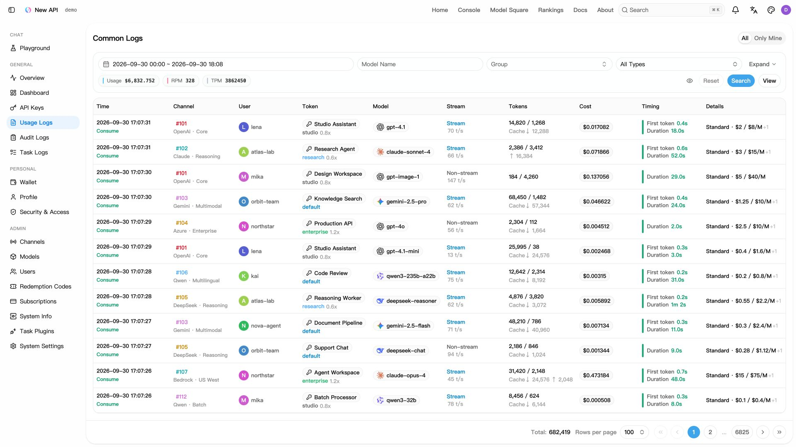

<div align="center">

# SmartRouter-v2

**One model endpoint. Traffic follows channel performance. Supplier data stays separate.**

Self-hosted AI gateway and LLM router built on new-api · adaptive multi-channel routing · priority tiers · session stickiness

[简体中文](./README.md) · **English**

<p>
  <a href="./go.mod"></a>
  <a href="./web/package.json"></a>
  <a href="./web/package.json"></a>
  <a href="./Dockerfile"></a>
  <a href="./LICENSE"></a>
  <a href="https://github.com/d100000/SmartRouter-v2/commits/main/"></a>
</p>

[Features](#sr-purpose) · [Quick start](#sr-start) · [Routing](#sr-routing) · [Suppliers](#sr-suppliers) · [Channel limits](#sr-channel-limits) · [Configuration](#sr-config) · [Development](#sr-development) · [Contributing](#sr-contributing) · [Upstream and license](#sr-upstream)

</div>

SmartRouter-v2 is a self-hosted AI gateway (LLM gateway) for teams that manage several upstream channels, operate a model service, or work with external suppliers. Applications call models through one API compatible with OpenAI, Anthropic (Claude) and Gemini; the platform handles access checks, channel selection, usage records and quota. When one model is served by several channels, traffic is distributed by success rate, time to first output and load, and moves away from a failing channel. Suppliers maintain their own channels in a separate workspace.

<p align="center">
  <a href="./assets/screenshots/dashboard.en.jpg"></a>
  <br>
  <sub>Console preview, based on New API (demo data)</sub>
</p>

This project is built on [new-api](https://github.com/QuantumNous/new-api). It keeps new-api's model access and management and adds adaptive channel scheduling (priority tiers, session stickiness, failure cooldown), a supplier workspace, per-channel limits and error analysis. The original project's attribution, license and README are kept [at the end](#sr-upstream).

### When it fits

- One model is served by several upstream channels, and traffic should follow real success rate and latency, with automatic failover.
- You have primary and backup channels: the backup should stay idle and take over only when the primary is unhealthy.
- Long sessions rely on upstream prompt caching, so a session should stay on one channel.
- External suppliers provide capacity and need isolated data and their own limits.
- Requests per minute, tokens per minute and daily purchase cost must be limited per channel.

<a id="sr-purpose"></a>

## Features

| Capability | What you can do |
| --- | --- |
| Unified model endpoint | Use OpenAI Chat / Responses, Anthropic Messages and Gemini, plus supported image, audio, embedding and rerank endpoints |
| Adaptive channel routing | Distribute traffic by channel success rate, time to first output and current load; channel priority and weight still apply; new channels ramp up gradually, failing channels cool down and are probed for recovery, with controlled retries and capacity protection |
| Session stickiness | With channel affinity enabled, a session keeps using the same channel to preserve the upstream prompt cache; it yields when the channel keeps failing and returns to a higher-priority channel after being idle |
| Supplier workspace | Administrators create supplier accounts; suppliers maintain their own channels, models, on/off state and internal priority, and see their own supply data |
| Channel viewer | A regular user with read-only access to non-secret information of all channels, keeping their own API keys, calls and account features |
| Channel usage limits | Set RPM, TPM and a daily purchase-cost budget per channel; administrators manage all channels, suppliers manage their own |
| Asynchronous and realtime calls | Supported task plugins, Midjourney/SwapFace tasks, and per-generation admission control for Responses WebSocket and Realtime |
| Operations and cost | Channel usage, cache statistics, purchase cost, stability, task status, budget events and redacted logs, with real usage kept apart from unknown outcomes |
| Error analysis | Summarize failed requests of a chosen period, merge them by error type, and have a model you configure write a report: severity, affected requests, channels and models involved, investigation steps |
| Platform management | Users, groups, quotas, subscriptions, model pricing, audit and account security as in new-api, plus monitoring and recovery of channels whose upstream balance has run out |

Endpoint availability depends on the upstream model, the channel type and the enabled templates or plugins. Protocol conversion does not mean every upstream-specific field, tool call or multimodal feature maps without loss.

<a id="sr-start"></a>

## Quick start

### Build the Docker image from this repository

To use the routing features of this fork, build this source tree. The repository's `docker-compose.yml` still defaults to the upstream `calciumion/new-api:latest` image, which does not contain them.

The commands below suit a first local trial. They use SQLite and keep data in `smartrouter-v2-data/` outside the repository. Git, Docker and OpenSSL are required:

```bash
git clone https://github.com/d100000/SmartRouter-v2.git
cd SmartRouter-v2

# Keep persistent configuration outside the repository; existing files are left unchanged
SMARTROUTER_ENV_FILE="$(pwd)/../smartrouter-v2.env"
SMARTROUTER_DATA_DIR="$(pwd)/../smartrouter-v2-data"
if [ ! -e "$SMARTROUTER_ENV_FILE" ]; then
  (
    umask 077
    set -C
    printf 'SESSION_SECRET=%s\n' "$(openssl rand -hex 32)" > "$SMARTROUTER_ENV_FILE"
  )
fi

# Write the Git version into the frontend build information
docker build \
  --build-arg VITE_PROJECT_VERSION="$(git rev-parse --short=9 HEAD)" \
  --build-arg VITE_PROJECT_VERSION_DATE="$(git show -s --format=%cI HEAD)" \
  -t smartrouter-v2:local .

mkdir -p "$SMARTROUTER_DATA_DIR"
docker run --name smartrouter-v2 -d --restart unless-stopped \
  -p 127.0.0.1:3000:3000 \
  --env-file "$SMARTROUTER_ENV_FILE" \
  -e TZ=Asia/Shanghai \
  -v "$SMARTROUTER_DATA_DIR:/data" \
  smartrouter-v2:local
```

Open [http://localhost:3000](http://localhost:3000) and create the administrator account in the setup wizard. You choose the administrator password during setup; there is no preset default. Before upgrading an existing instance, back up the database and secrets and keep using the existing `smartrouter-v2.env`. Configuration and data stay outside the repository and outside the Docker build context; the environment file is created readable and writable by the current user only.

### Send the first request

1. Add a channel in the console: upstream address, credentials, models and group. Run the channel test.
2. Set model prices and user quota, and create an API key.
3. Point the client's base URL to `http://localhost:3000/v1` and use your key.
4. After adding several channels for the same model, set capacity and policy in the scheduling center according to real supply, and watch the results of real calls.

Replace the model name with an enabled model and set `SMARTROUTER_API_KEY` in your shell:

```bash
curl --fail-with-body http://localhost:3000/v1/chat/completions \
  -H "Authorization: Bearer ${SMARTROUTER_API_KEY}" \
  -H "Content-Type: application/json" \
  -d '{"model":"your-enabled-model","messages":[{"role":"user","content":"Hello!"}],"stream":true}'
```

### Enable supplier supply

An administrator first configures authorization templates, available models and the purchase-cost rules that are needed under "Channel suppliers", then creates a "channel supplier" account in user management and assigns it to the supplier. A supplier must change the password at first login, then submits channel configuration and completes model verification for the protocol; asynchronous models must reach a successful final task state, acceptance alone is not enough.

Submitting supplier credentials requires **HTTPS, a Secure session cookie and a configured encryption key ring**. The local HTTP example above is fine for trying the console, but it does not bypass the transport protection of supplier credential submission. For real suppliers, put the instance behind HTTPS and check the reverse-proxy settings.

<a id="sr-routing"></a>

## How a request reaches the upstream



The application chooses the model; SmartRouter-v2 chooses a channel for it. Scheduling first applies group, model, protocol, supply state and request policy, then adjusts traffic by recent success rate, time to first output and load.

- **Priority and weight**: tiers are strict by default. While a higher-priority channel is healthy it takes all first assignments, and a lower tier only receives what the higher tier cannot carry. Inside a tier, traffic follows the configured weights, adjusted by performance. A weight of 0 does not stop a channel; disable the channel instead.
- **Gradual learning**: a new channel starts with limited traffic while it collects samples, and exploration is limited while healthy alternatives exist.
- **Failure cooldown**: after 3 different requests fail in a row, the channel cools down for that group and model (15 seconds at first, doubling on consecutive cooldowns, at most 5 minutes). When the cooldown ends, one probe request confirms recovery. The last available channel is never cooled down.
- **Failover**: when a request is retryable and no response has started, another eligible channel is tried. A request is never replayed after output has been sent.
- **Session stickiness**: with channel affinity enabled, a session prefers its bound channel. It yields to a healthy channel when the bound one keeps failing, and a session that moved to a lower tier during a failure returns to the higher tier after 5 idle minutes.
- **Capacity protection**: channels that share one upstream account can share a capacity pool within an instance, limiting concurrent dispatch.
- **Scope of control**: administrators control supplier pools and platform-wide scheduling; a supplier's priority changes apply to its own channel pool only.

Metrics, the weight formula and all defaults are described in [SCHEDULING.md](./SCHEDULING.md) (Chinese).

<a id="sr-suppliers"></a>

## Suppliers and permissions

The supplier role is for supplying capacity; the channel viewer role is for observing channels. They have different scopes.

To grant channel viewing: create a regular user, choose "Grant channel viewing" in the row menu of the user list, and complete identity verification.

| Action | Regular user | Channel viewer | Channel supplier | Platform administrator |
| --- | --- | --- | --- | --- |
| Own API keys, model calls and account | Existing rules | Keeps all regular-user features | Dedicated supply account, no consumer features | Existing rules |
| View non-secret channel information | No access to all channels | All channels, read-only | Own channels only | By administrator permission |
| Create, change, pause channels | No | No | Own channels and authorized settings | By administrator permission |
| Adjust priority inside the supplier pool | No | No | Own channel pool only | Yes |
| Configure platform-wide scheduling priority | No | No | No | Yes |
| Set channel RPM, TPM, daily budget | No | No | Own channels only | All channels |
| View and export supply logs | No | Not granted | Own redacted records only | By administrator permission |
| Read back protected upstream channel keys | No | No | No | No |

Supplier A cannot see supplier B's channels, request logs, statistics, filter options or history. Isolation is enforced by the backend. History is shown according to the supplier ownership recorded at call time and is not reassigned when a channel changes owner.

A supplier can see the daily purchase budget, used, reserved and remaining amounts of its own channels. This does not expose customer prices, platform revenue, margin, other users' identities or request content. A channel viewer can manage their own consumer keys but cannot read upstream channel keys or gain cross-user request logs through the read-only permission.

Protected credentials are submitted over HTTPS and stored encrypted; management APIs never return them in clear text, and copying a channel or changing its owner does not lift the write-only protection. The platform still uses the credentials to authenticate upstream requests.

<a id="sr-channel-limits"></a>

## Channel RPM, TPM and daily budget

The three limits are configured independently. **A limit that is unset or turned off does not apply.** Suppliers can adjust the limits of their own channels but cannot lift an administrator's supply suspension.

| Limit | What is counted | Recovery |
| --- | --- | --- |
| RPM | Business inference requests or task submissions actually sent upstream; real retries count | Admission resumes as the rolling 60-second window releases |
| TPM | Text input and output tokens of applicable protocols, reserved before sending and corrected with trusted usage | Admission resumes as the reservation releases; templates without text-token semantics do not invent token usage |
| Daily purchase-cost budget | Channel purchase cost recorded by the platform, in USD; used and in-flight reserved amounts both count at admission | New calls stop once the day's budget is used up; the daily limit lifts at 00:00 Beijing time |

One channel's counters are shared by all its models, keys, customer groups and gateway instances. Channels count separately; a channel budget is not a supplier total budget or a shared upstream-account limit.

**Midnight lifts the daily budget only.** Manual pauses, administrator suspensions, health problems, business hours and per-minute limits still apply; changing a limit does not reset usage. A request that crosses midnight stays in its original budget day, and a customer refund does not reduce purchase cost directly.

Requests already sent and tasks already submitted finish normally; a new generation on a WebSocket is checked again. Task polling and result downloads do not consume business RPM again. Unknown usage and cost stay unknown or conservatively reserved rather than zero; late results correct the original record.

A daily budget needs valid purchase-cost rules. The cost the platform accounts may be an estimate and is not the upstream's final bill; concurrent reservation lowers the risk of overspending but cannot guarantee the final upstream bill never exceeds the budget.

<a id="sr-console"></a>

## Console and operations

| Page | Purpose |
| --- | --- |
| Scheduling center | Recent performance per group and model, channel weights, time to first output, cooldown and capacity use; routing policy configuration |
| Channel overview | Channel calls, usage, cache and cost, compared along the available dimensions |
| Supplier management | Create supplier identities, set authorization scope, supply state and platform pool policy, see which supplier owns a channel |
| Supplier workspace | Maintain own channels, model verification, internal order and limits; view own overview, stability and supply logs |
| Error analysis | Administrators pick a period and generate a failure report; after entering the analysis model's address and key the model list can be fetched, and common models get a matching context budget |
| Logs and audit | Authorized call records, abnormal states and management events; suppliers only get the permitted redacted fields |

For asynchronous tasks, "submitted" and "completed" are recorded separately; completion state, duration and media usage depend on verifiable upstream results. A realtime connection that was established does not mean later generations succeed; each new generation goes through admission and metering on its own.

<a id="sr-config"></a>

## Deployment configuration

| Setting | Description |
| --- | --- |
| `SQL_DSN` | Main database connection string; SQLite, MySQL ≥ 5.7.8 and PostgreSQL ≥ 9.6 are supported; SQLite is used when unset |
| `LOG_SQL_DSN` | Optional separate log database; the log database additionally supports ClickHouse |
| `REDIS_CONN_STRING` | Redis connection string; enabling Redis does not change the single-instance scope of the routing capacity pools |
| `SESSION_SECRET` | Persistent session secret; keep it identical across instances as your deployment requires |
| `SUPPLIER_CREDENTIAL_KEYS` | Supplier credential encryption key ring, a JSON object; each version's value is a Base64-encoded random 32-byte key |
| `SUPPLIER_CREDENTIAL_ACTIVE_KEY` | Key version used to encrypt new credentials; it must exist in the key ring |
| `SESSION_COOKIE_SECURE` | Set to `true` for HTTPS deployments together with `SESSION_COOKIE_TRUSTED_URL`; supplier credential submission requires secure sessions |
| `SESSION_COOKIE_TRUSTED_URL` | The exact HTTPS browser origins allowed, as described in the authentication guide |
| `TRUSTED_PROXIES` | Trusted reverse-proxy IPs/CIDRs, listed explicitly; the proxy must overwrite `X-Forwarded-Proto` with the real value, client-supplied values must not be trusted |
| `ERROR_ANALYSIS_EVIDENCE_RETENTION_DAYS` | Optional. Days to keep per-request evidence of error analyses, default `30`; `0` keeps it until the report is deleted |
| `ERROR_ANALYSIS_SCAN_ROWS_PER_SECOND` | Optional. Upper bound on how fast error analysis reads the log database, default `20000` rows per second; `0` removes the bound |

Key ring example; replace the content in angle brackets with a generated secret:

```dotenv
SUPPLIER_CREDENTIAL_KEYS={"v1":"<base64-encoded-32-byte-secret>"}
SUPPLIER_CREDENTIAL_ACTIVE_KEY=v1
```

`openssl rand -base64 32` generates one key version. The key ring is kept by the operator, never in the business database, a public repository or logs. When rotating, keep every old version still referenced by existing ciphertext; switching the active version does not re-encrypt existing channels, drafts or task snapshots, and an old version may be removed only after migration is complete and no reference remains. A database backup does not replace a backup of the encryption keys.

See [.env.example](./.env.example) and the [authentication and session guide](./docs/authentication.md) for the full configuration. The reverse proxy must support streaming and WebSocket upgrades. When deploying with the [Compose file](./docker-compose.yml), replace the application image with the one built from this repository and set real database connections and secrets.

<a id="sr-limits"></a>

## Current boundaries

- **Channel scheduling** chooses a channel for the model the request names, based on call performance. It does not read prompts to choose a model, judge answer quality or promise a fixed SLA.
- **Coordination between instances**: scheduling statistics, cooldown and shared capacity pools live inside one instance. Channel RPM, TPM and daily budget are coordinated between instances that use the same main database, through persisted permits and a ledger. These are two different kinds of limit.
- **Protocol coverage**: suppliers can only use templates that are open and verified. Some asynchronous actions that depend on source material need the matching context; not every plugin or upstream action can be verified automatically.
- **Trust in statistics**: without traffic or trusted usage, values are shown as missing or unknown. Request estimates are not presented as completed usage, and purchase estimates are not presented as vendor invoices.
- **Roles**: in this first phase a supplier uses a dedicated account. There is no supplier self-registration, multi-employee organization or switching between consumer and supplier identities, and the purchase budget is not a supplier payment system.

Supplier permissions, limits and recovery rules are defined in the [channel supplier product plan](./design-plans/channel-supplier-role-product-plan.md) (Chinese). Scheduling background is in [SCHEDULING.md](./SCHEDULING.md); check algorithm details against the current source.

<a id="sr-development"></a>

## Local development

The backend uses Go, Gin and GORM; the frontend uses React 19, TypeScript, Rsbuild, TanStack, Base UI and Tailwind CSS 4. The Go version of the root module is in [go.mod](./go.mod), currently Go 1.26.10; the frontend uses Bun 1.4.4. Dependency versions are those in the repository files.

```bash
# Build the frontend assets the backend embeds
cd web
bun install --frozen-lockfile
bun run build
cd ..

go run .
```

For frontend hot reload, run in another terminal:

```bash
cd web
bun run dev -- --host 127.0.0.1 --port 5173
```

Open [http://localhost:5173](http://localhost:5173); the development server proxies API requests to `http://localhost:3000`. `make dev-api` starts a source-built PostgreSQL / Redis development stack. Build the frontend before building or testing the root module, so the embedded assets are not cleaned during the build.

| Directory | Responsibility |
| --- | --- |
| `controller/`, `middleware/`, `router/` | Management APIs, access checks and routes |
| `service/`, `model/` | Scheduling integration, task handling, data models, supplier and channel permit ledger |
| `pkg/scheduler/` | Scheduling windows, scoring, capacity and recovery policy |
| `relay/` | Upstream request and response handling |
| `relaykit/`, `tokenkit/` | Independent modules for protocol conversion and token counting |
| `web/` | Admin console, supplier workspace and user interface |
| `plugins/tasks/` | JavaScript asynchronous task plugins |

<a id="sr-contributing"></a>

## Contributing

Bug reports, documentation fixes and code are welcome. The process is in the [contributing guide](./CONTRIBUTING.md#english); please follow the [Code of Conduct](./.github/CODE_OF_CONDUCT.md). Read [AGENTS.md](./AGENTS.md) before changing code, and [web/AGENTS.md](./web/AGENTS.md) for frontend work. Submit only files related to the task, and verify permission, metering, ledger and protocol behavior that you change.

Common checks:

```bash
# Repository root, after the frontend build
go test ./...
go build ./...

# In web/
bun run lint
bun run typecheck
bun run test
bun run build
```

`relaykit/` and `tokenkit/` build independently; when changing them, run `GOWORK=off go test ./...` and `GOWORK=off go build ./...` in their directories. Changes that affect database behavior must also be verified on SQLite, MySQL and PostgreSQL.

[Open an issue](https://github.com/d100000/SmartRouter-v2/issues) · [Open a pull request](https://github.com/d100000/SmartRouter-v2/pulls) · [Recent changes](https://github.com/d100000/SmartRouter-v2/commits/main/)

<a id="sr-security"></a>

## Security

Please do not disclose security vulnerabilities in public issues.

- Vulnerabilities in the features this project adds (scheduling, suppliers, channel limits, error analysis): report them through this repository's [private vulnerability reporting](https://github.com/d100000/SmartRouter-v2/security/advisories/new).
- Vulnerabilities that also exist in upstream new-api: report them to the upstream project as described in the [security policy](./.github/SECURITY.md).

<a id="sr-support"></a>

## Getting help

| Need | Where |
| --- | --- |
| Bug reports, feature requests | [GitHub Issues](https://github.com/d100000/SmartRouter-v2/issues) |
| Scheduling metrics, weight formula, operator workflow | [SCHEDULING.md](./SCHEDULING.md) (Chinese) |
| Supplier permissions, limits and recovery rules | [Channel supplier product plan](./design-plans/channel-supplier-role-product-plan.md) (Chinese) |
| Authentication and login sessions | [docs/authentication.md](./docs/authentication.md) |
| Channels, tokens, billing and other base features | [new-api documentation](https://docs.newapi.ai/) |

<a id="sr-upstream"></a>

## Upstream and license

SmartRouter-v2 is built on **new-api / QuantumNous** and is licensed under [AGPLv3](./LICENSE) with the additional terms in [NOTICE](./NOTICE). The original project's identifiers, author attribution and third-party notices are preserved; dependency licenses are in [THIRD-PARTY-LICENSES.md](./THIRD-PARTY-LICENSES.md).

The original upstream README is kept in full below. Its screenshots, partners, release channels and image instructions belong to the upstream project; to deploy this fork, build it as described under "Quick start" above.

<details>
<summary>Original upstream New API README, attribution and license</summary>

<div align="center">


# New API

**An AI gateway for models, applications, and agents**

<p align="center">
  <a href="./README.zh_CN.md">简体中文</a> |
  <a href="./README.zh_TW.md">繁體中文</a> |
  <strong>English</strong> |
  <a href="./README.fr.md">Français</a> |
  <a href="./README.ja.md">日本語</a>
</p>

<p align="center">
  <a href="https://raw.githubusercontent.com/Calcium-Ion/new-api/main/LICENSE">
    
  </a>
  <a href="https://github.com/Calcium-Ion/new-api/releases/latest">
    
  </a>
  <a href="https://github.com/users/Calcium-Ion/packages/container/package/new-api">
    
  </a>
  <a href="https://hub.docker.com/r/CalciumIon/new-api">
    
  </a>
  <a href="https://atomgit.com/QuantumNous/new-api" target="_blank">
    
  </a>
</p>

<p align="center">
  <a href="https://trendshift.io/repositories/20180" target="_blank">
    
  </a>
  <br>
  <a href="https://hellogithub.com/repository/QuantumNous/new-api" target="_blank">
    
  </a>
  <a href="https://atomgit.com/QuantumNous/new-api" target="_blank">
    
  </a>
</p>

<p align="center">
  <a href="#screenshots">Screenshots</a> •
  <a href="#capabilities">Capabilities</a> •
  <a href="#quick-start">Quick start</a> •
  <a href="#deployment">Deployment</a> •
  <a href="#development">Development</a> •
  <a href="#documentation">Documentation</a>
</p>

</div>

---

## 📝 Project Description

New API is a self-hosted AI gateway for applications, agents, and teams. Connect upstream model services, expose a consistent API to your clients, and manage routing, access, usage, and costs in one place.

Use it to share authorized model access across a team, switch providers without configuring every client again, or operate a private multi-model service with a web console. Upstreams include OpenAI, Anthropic, Google Gemini, Azure OpenAI, AWS Bedrock, Vertex AI, DeepSeek, Qwen, and other compatible services.

> [!NOTE]
> This is an open-source project developed based on [One API](https://github.com/songquanpeng/one-api)

<!-- -->

> [!IMPORTANT]
> - This project is intended solely for lawful and authorized AI API gateway, organization-level authentication, multi-model management, usage analytics, cost accounting, and private deployment scenarios.
> - Users must lawfully obtain upstream API keys, accounts, model services, and interface permissions, and must comply with upstream terms of service and applicable laws and regulations.
> - Users should ensure their use complies with upstream terms of service and applicable laws and regulations.
> - When providing generative AI services to the public, users should comply with applicable regulatory requirements and fulfill all filing, licensing, content safety, real-name verification, log retention, tax, and upstream authorization obligations required by their jurisdiction.

<!-- -->

> [!WARNING]
> When operating this project as a public generative AI service or API resale service, users should first complete all required filing, licensing, content safety, real-name verification, log retention, tax, payment, and upstream authorization obligations.

---

<a id="screenshots"></a>

## Screenshots

Accounts, channels, plugin installation states, usage, prices, and costs shown below are simulated data. The marketplace displays the official plugin catalog. Click an image to view it at full size.

| Usage dashboard | Plugin marketplace |
| --- | --- |
| [](assets/screenshots/dashboard.en.jpg) | [](assets/screenshots/plugin-marketplace.en.jpg) |
| **Model square** | **Usage logs** |
| [](assets/screenshots/models.en.jpg) | [](assets/screenshots/usage-logs.en.jpg) |

---

## 🤝 Trusted Partners

<p align="center">
  <em>No particular order</em>
</p>

<p align="center">
  <a href="https://www.cherry-ai.com/" target="_blank">
    
  </a>
  <a href="https://bda.pku.edu.cn/" target="_blank">
    
  </a>
  <a href="https://www.aliyun.com/" target="_blank">
    
  </a>
  <a href="https://io.net/" target="_blank">
    
  </a>
</p>

---

## 🙏 Special Thanks

<p align="center">
  <a href="https://www.jetbrains.com/?from=new-api" target="_blank">
    
  </a>
</p>

<p align="center">
  <strong>Thanks to <a href="https://www.jetbrains.com/?from=new-api">JetBrains</a> for providing free open-source development license for this project</strong>
</p>

---

<a id="capabilities"></a>

## Capabilities

| Area | What you can do |
| --- | --- |
| Model access | Use OpenAI Chat Completions, Responses, Anthropic Messages, and Gemini APIs; stream responses and use tools, reasoning, and multimodal inputs where supported |
| Routing | Configure model mappings, channel priorities and weights, retries, channel affinity, and multiple upstream keys |
| Usage and costs | Manage quotas, subscriptions, usage logs, cache accounting, and expression-based pricing for different usage tiers |
| Access control | Manage users, groups, fine-grained permissions, and API key restrictions; use OAuth/OIDC, passkeys, two-factor authentication, and login session management |
| Asynchronous tasks | Extend image, video, and other task APIs with JavaScript plugins, including task status and output retrieval |
| Web console | Configure channels and models, inspect usage and audit logs, and try models in the playground; available in English, Simplified Chinese, Traditional Chinese, French, Japanese, Russian, and Vietnamese |

### Protocols and endpoints

| Interface | Common endpoints |
| --- | --- |
| OpenAI Chat / Responses | `POST /v1/chat/completions`, `POST /v1/responses` |
| Anthropic Messages | `POST /v1/messages` |
| Gemini | `POST /v1beta/models/{model}:generateContent`, `POST /v1beta/models/{model}:streamGenerateContent` |
| Realtime / Responses WebSocket | `GET /v1/realtime`, `GET /v1/responses` (WebSocket upgrade) |
| Images / audio | `/v1/images/generations`, `/v1/images/edits`, `/v1/audio/speech`, `/v1/audio/transcriptions`, `/v1/audio/translations` |
| Embeddings / rerank | `POST /v1/embeddings`, `POST /v1/rerank` |
| Task plugins | `POST /v1/tasks/{pluginKey}`, `GET /v1/tasks/{taskId}`, plus routes declared by each plugin |

[RelayKit](./relaykit/README.md) provides request, response, and streaming conversion between the four text protocols. Available features depend on the channel, upstream model, and conversion path; protocol-specific tools and fields may not map exactly. WebSocket support also requires a compatible upstream and channel configuration.

This README describes the current source tree. Check the release notes for the version you deploy.

<a id="quick-start"></a>

## Quick start

### Try locally with Docker

This starts a single instance with SQLite and binds it to localhost:

```bash
mkdir -p data
docker run --name new-api -d --restart unless-stopped \
  -p 127.0.0.1:3000:3000 \
  -e TZ=Asia/Shanghai \
  -v "$(pwd)/data:/data" \
  calciumion/new-api:latest
```

Open [http://localhost:3000](http://localhost:3000) and complete the setup wizard to create the administrator account. The `data` directory persists the SQLite database across container replacements.

### Make your first request

1. Add a channel with your upstream API key, available models, and group assignment; run a channel test.
2. Configure model pricing and ensure the user has quota or a valid subscription.
3. Create an API key in the console with access to the same group and models.
4. Set your client's base URL to `http://localhost:3000/v1` for OpenAI-compatible clients and use the **New API-issued key**.

Set `NEW_API_KEY` in your shell to that key. List the models accessible to it:

```bash
curl --fail-with-body http://localhost:3000/v1/models \
  -H "Authorization: Bearer ${NEW_API_KEY}"
```

Then call Responses, replacing `your-enabled-model` with an enabled model that supports this interface:

```bash
curl --fail-with-body http://localhost:3000/v1/responses \
  -H "Authorization: Bearer ${NEW_API_KEY}" \
  -H "Content-Type: application/json" \
  -d '{"model":"your-enabled-model","input":"Hello!"}'
```

<a id="deployment"></a>

## Deployment

### Docker Compose

The repository's [Compose configuration](./docker-compose.yml) starts **New API + PostgreSQL + Redis** by default. It also contains examples for MySQL and a separate ClickHouse log database.

```bash
git clone https://github.com/QuantumNous/new-api.git
cd new-api
```

Before starting, edit `docker-compose.yml`: replace the database and Redis example passwords in both the services and connection strings, and set a persistent random `SESSION_SECRET` (generate one with `openssl rand -hex 32`). For an HTTPS console, configure `SESSION_COOKIE_SECURE=true` and `SESSION_COOKIE_TRUSTED_URL` with its exact public HTTPS origin.

```bash
docker compose up -d
docker compose logs -f new-api
```

### Storage and configuration

| Component | Options |
| --- | --- |
| Main database | SQLite, MySQL ≥ 5.7.8, or PostgreSQL ≥ 9.6 |
| Separate log database | Configure with `LOG_SQL_DSN`; also supports ClickHouse |
| Cache | Optional Redis plus in-memory caching; use shared Redis when application nodes need shared rate limits |
| Container platforms | Linux amd64 / arm64 |

| Variable | Purpose |
| --- | --- |
| `SQL_DSN` | Main database connection; unset uses SQLite |
| `LOG_SQL_DSN` | Optional separate log database connection |
| `REDIS_CONN_STRING` | Redis connection string |
| `SESSION_SECRET` | Persistent authentication secret; all nodes must use the same value |
| `CRYPTO_SECRET` | Defaults to `SESSION_SECRET`; nodes sharing Redis must use the same effective value |
| `SESSION_COOKIE_SECURE` | Set to `true` for an HTTPS console; enables Secure refresh cookies and strict refresh/logout origin checks |
| `SESSION_COOKIE_TRUSTED_URL` | Required in Secure mode: comma-separated exact HTTPS origins, without paths or wildcards; leave unset for local HTTP |
| `TRUSTED_PROXIES` | Trusted reverse-proxy IPs/CIDRs, or `none`; explicitly configure for your network |

See the [environment example](./.env.example), [environment reference](https://docs.newapi.ai/en/docs/installation/config-maintenance/environment-variables), and [authentication and session guide](./docs/authentication.md) for full configuration. Configure container variables in Compose's `environment` or `env_file`; copying `.env.example` alone does not inject variables into the container.

For production, put the console behind HTTPS and configure your reverse proxy for streaming and WebSocket upgrades. Persist and back up the database and mounted data. Multi-node deployments must share the main database and authentication secrets; separate Redis instances or in-memory rate limiters count limits independently per node. The session guide describes propagation behavior for each topology.

Pin an image version from [Releases](https://github.com/QuantumNous/new-api/releases), review its upgrade notes, and back up before upgrading. The `latest` tag follows published builds and can change; migrations and compatibility must be assessed for your existing installation.

<a id="development"></a>

## Development and extensions

The backend uses Go and Gin. The web console uses React 19, TypeScript, Rsbuild, TanStack, and Tailwind CSS 4. Use Bun for frontend dependencies and scripts; see [go.mod](./go.mod) for the Go language baseline and [Dockerfile](./Dockerfile) for the container build toolchain.

Build the frontend before starting the backend, which embeds `web/dist`:

```bash
# Repository root
cd web
bun install --frozen-lockfile
bun run build
cd ..
go run .
```

In a second terminal, start the frontend development server:

```bash
cd web
bun run dev -- --port 5173
```

Open [http://localhost:5173](http://localhost:5173); the development server proxies API requests to the backend on port 3000. For a containerized development backend, see [docker-compose.dev.yml](./docker-compose.dev.yml) and the `make dev` target in [makefile](./makefile).

| Location | Responsibility |
| --- | --- |
| `router/`, `middleware/`, `controller/` | HTTP routes, access checks, and API handlers |
| `relay/` | Upstream adapters and request routing |
| `service/`, `model/` | Business logic and persistence |
| [relaykit/](./relaykit/README.md) | Independently buildable Go module for protocol DTOs and conversions |
| [plugins/tasks/](./plugins/tasks/) | JavaScript task plugins; see [Task Plugin API v1](./docs/plugin-api/v1.md) for authoring and host boundaries |
| `web/` | Web console; see [frontend conventions](./web/AGENTS.md) |
| [electron/](./electron/README.md) | Desktop wrapper and packaging |

Read [AGENTS.md](./AGENTS.md) before contributing. Run checks appropriate to your change, including `make test` for the Go modules and `bun check -b`, `bun run lint`, `bun run test`, and `bun run build` in `web/` for frontend changes. Changes to RelayKit must also pass `GOWORK=off go build ./...` from `relaykit/`.

<a id="documentation"></a>

## Documentation and community

| Resource | Link |
| --- | --- |
| Official documentation | [Guides](https://docs.newapi.ai/en/docs) · [Installation](https://docs.newapi.ai/en/docs/installation) · [API reference](https://docs.newapi.ai/en/docs/api) |
| Project exploration | [DeepWiki](https://deepwiki.com/QuantumNous/new-api) |
| Questions and discussion | [FAQ](https://docs.newapi.ai/en/docs/support/faq) · [Community](https://docs.newapi.ai/en/docs/support/community-interaction) |
| Bugs and feature requests | [GitHub Issues](https://github.com/QuantumNous/new-api/issues) |
| Security reports | Follow the [security policy](./.github/SECURITY.md) for private reporting |

For bug reports, include the version, deployment method, reproduction steps, and redacted logs. Documentation, translations, provider integrations, and focused regression tests are all welcome contributions.

---

## 🔗 Related Projects

### Upstream Projects

| Project | Description |
|------|------|
| [One API](https://github.com/songquanpeng/one-api) | Original project base |
| [Midjourney-Proxy](https://github.com/novicezk/midjourney-proxy) | Midjourney interface support |

### Supporting Tools

| Project | Description |
|------|------|
| [new-api-key-tool](https://github.com/Calcium-Ion/new-api-key-tool) | Key quota query tool |
| [new-api-horizon](https://github.com/Calcium-Ion/new-api-horizon) | New API high-performance optimized version |

---

## 📜 License

This project is licensed under the [GNU Affero General Public License v3.0 (AGPLv3)](./LICENSE).

Additional terms under AGPLv3 Section 7 apply. Modified versions must preserve
the author attribution notice `Frontend design and development by New API
contributors.` in the appropriate legal notices and in any prominent about,
legal, footer, or attribution location presented by the user interface.

Modified versions that present a user interface must also preserve a visible
link to the original project: <https://github.com/QuantumNous/new-api>.

This is an open-source project developed based on [One API](https://github.com/songquanpeng/one-api) (MIT License).

If your organization's policies do not permit the use of AGPLv3-licensed software, or if you wish to avoid the open-source obligations of AGPLv3, please contact us at: [support@quantumnous.com](mailto:support@quantumnous.com)

See [NOTICE](./NOTICE) and [third-party licenses](./THIRD-PARTY-LICENSES.md) for attribution and dependency notices.

---

## 🌟 Star History

<div align="center">

[](https://star-history.com/#Calcium-Ion/new-api&Date)

</div>

---

<div align="center">

### 💖 Thank you for using New API

If this project is helpful to you, welcome to give us a ⭐️ Star！

**[Official Documentation](https://docs.newapi.ai/en/docs)** • **[Issue Feedback](https://github.com/Calcium-Ion/new-api/issues)** • **[Latest Release](https://github.com/Calcium-Ion/new-api/releases)**

<sub>Built with ❤️ by QuantumNous</sub>

</div>

</details>
