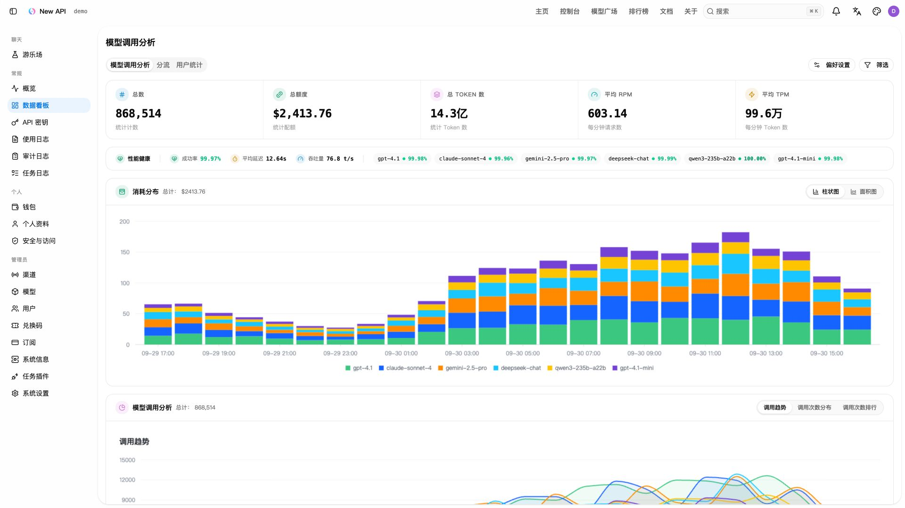
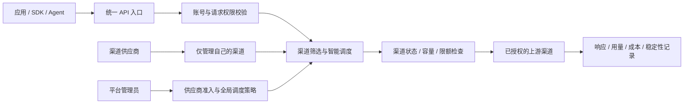
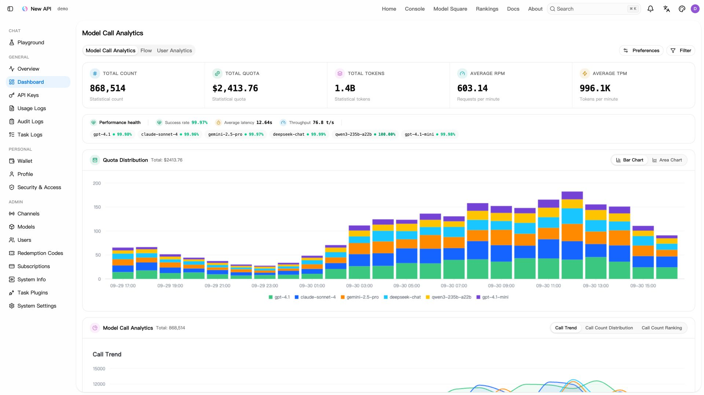
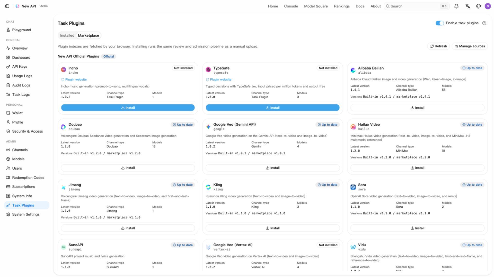
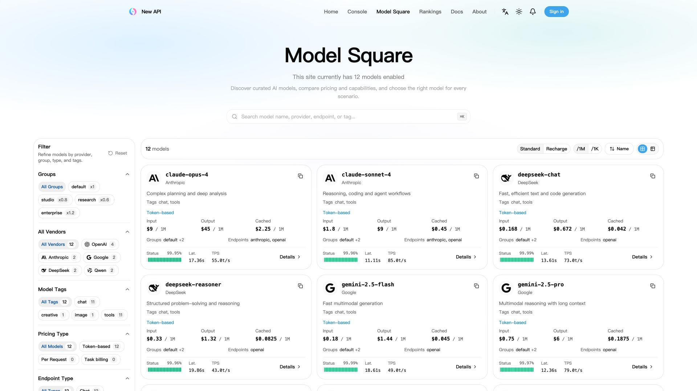
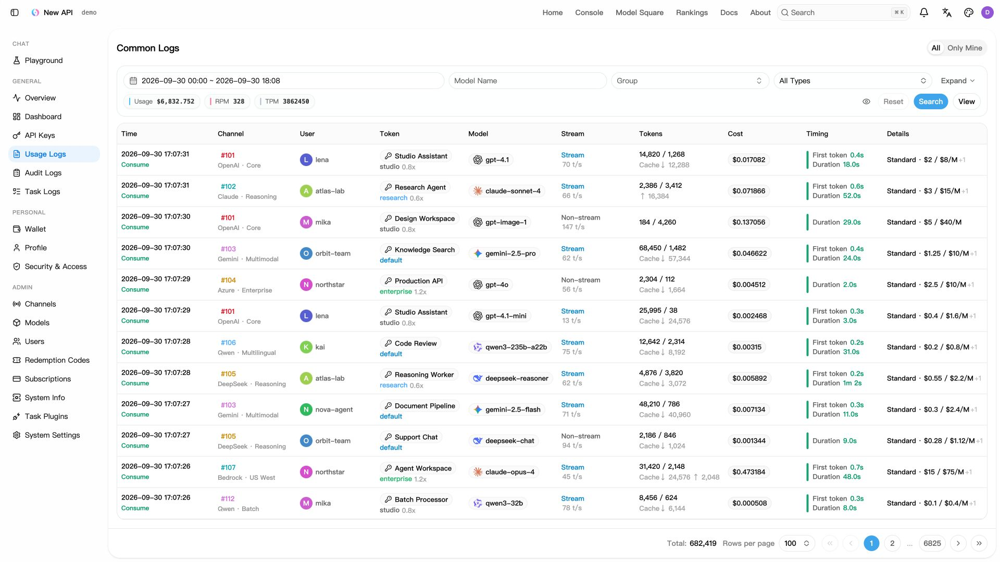

<div align="center">

# SmartRouter-v2 · 智能路由

**统一模型入口，智能分配流量，隔离供应商数据。**

<p>
  <a href="./go.mod"></a>
  <a href="./web/package.json"></a>
  <a href="./web/package.json"></a>
  <a href="./Dockerfile"></a>
  <a href="./LICENSE"></a>
</p>

[](https://github.com/d100000/SmartRouter-v2/commit/c6befee165a7a8c2f4a4a0f2278b684c01f1f409)
[main 最新提交](https://github.com/d100000/SmartRouter-v2/commits/main/)

**当前功能版本：`c6befee16` · 功能提交时间：2026-11-09 02:08:50（北京时间 / UTC+8）**

<p>
  <a href="#sr-start"></a>
  <a href="https://github.com/d100000/SmartRouter-v2/archive/refs/heads/main.zip"></a>
  <a href="#sr-suppliers"></a>
</p>

[功能介绍](#sr-purpose) · [渠道限额](#sr-channel-limits) · [本地开发](#sr-development) · [来源与许可证](#sr-upstream)

</div>

SmartRouter-v2 是一个可自行部署的 AI 网关，面向需要管理多个上游渠道、运营模型服务或与外部供应商协作的团队。应用通过统一 API 使用模型，平台负责权限校验、渠道选择、用量记录与额度控制；供应商在独立工作台维护自己的供货渠道。

<p align="center">
  <a href="./assets/screenshots/dashboard.zh-CN.jpg"></a>
  <br>
  <sub>基于 New API 的控制台预览（演示数据）</sub>
</p>

本项目基于 [new-api](https://github.com/QuantumNous/new-api) 开发，保留其模型接入与管理基础，重点扩展自适应渠道调度。原项目署名、许可与说明保留在[文末](#sr-upstream)。

<a id="sr-purpose"></a>

## 功能介绍

| 能力 | 可以做什么 |
| --- | --- |
| 统一模型入口 | 接入 OpenAI Chat / Responses、Anthropic Messages、Gemini，以及受支持的图像、音频、Embedding 和 Rerank 接口 |
| 自适应渠道路由 | 结合渠道成功表现、首输出延迟与当前负载分配流量，提供冷启动、故障降权、受控重试和容量保护 |
| 供应商工作台 | 管理员创建供应商账号；供应商维护自己的渠道、模型、启停、内部优先级，并查看自己的供货数据 |
| 渠道查看员 | 在普通用户能力上增加全渠道非秘密信息只读权限，保留本人 API Key、调用及个人账户能力 |
| 渠道用量限额 | 按渠道设置 RPM、TPM 和每日采购成本预算；管理员管理全部渠道，供应商管理本人渠道 |
| 异步与实时调用 | 接入受支持的任务插件、Midjourney/SwapFace 任务，以及 Responses WebSocket 和 Realtime 的逐次调用控制 |
| 运营与成本观察 | 查看渠道用量、缓存统计、采购成本、稳定性、任务状态、预算事件及脱敏日志，区分真实用量与未知结果 |
| 平台管理 | 沿用用户、分组、配额、订阅、模型计价、审计和账号安全能力，提供渠道欠费监控与恢复管理 |

接口可用性取决于上游模型、渠道类型和已启用的模板或插件。协议转换不意味着所有上游专有字段、工具调用或多模态能力都可以无损互通。

<a id="sr-routing"></a>

## 请求如何到达上游



应用选择要调用的模型，SmartRouter-v2 为这个模型选择可用渠道。调度过程先满足分组、模型、协议、供货状态和请求策略，再结合近期成功率、首输出延迟与负载调整流量。

- **逐步学习**：新渠道从受限流量开始积累样本，在有健康替代渠道时控制试探流量。
- **故障回退**：符合重试条件且响应尚未开始时，尝试其他合格渠道；不会在已输出内容后自动重放整个请求。
- **容量保护**：同一实例内可为共用上游账号的渠道配置共享容量池，限制同时派发量。
- **分层优先级**：管理员控制供应商池及平台全局调度；供应商调整的优先级只作用于自己的渠道池。

<a id="sr-suppliers"></a>

## 供应商与权限

供应商身份用于供货，渠道查看员用于观察渠道。两者拥有不同的工作范围。

授予渠道查看权限：先创建普通用户，再在用户列表的行菜单中选择“授予渠道查看权限”，按提示完成身份验证。

| 操作 | 普通用户 | 渠道查看员 | 渠道供应商 | 平台管理员 |
| --- | --- | --- | --- | --- |
| 本人 API Key、模型调用与个人账户 | 按现有规则 | 保留普通用户全部能力 | 专用供货账号不提供消费者能力 | 按现有规则 |
| 查看渠道非秘密信息 | 不提供全渠道查看 | 全部渠道，只读 | 仅本人渠道 | 按管理员权限 |
| 创建、修改、暂停渠道 | 不允许 | 不允许 | 仅本人渠道及获授权配置 | 按管理员权限 |
| 调整供应商内部优先级 | 不允许 | 不允许 | 仅本人渠道池 | 允许 |
| 配置平台全局调度优先级 | 不允许 | 不允许 | 不允许 | 允许 |
| 设置渠道 RPM、TPM、每日预算 | 不允许 | 不允许 | 仅本人渠道 | 全部渠道 |
| 查看供应商供货日志及导出 | 不允许 | 不额外授予 | 仅本人的脱敏记录 | 按管理员权限 |
| 回读受保护的上游渠道 Key | 不允许 | 不允许 | 不允许 | 不允许 |

供应商 A 看不到供应商 B 的渠道、请求日志、统计、筛选项或历史明细。隔离由后端执行，历史数据按照调用时的供应商归属快照展示，不根据当前渠道归属重新分配。

供应商可查看本人渠道的日采购预算、已用、预占和剩余金额；这不开放客户售价、平台收入、利润、其他用户身份或请求内容。渠道查看员可以管理自己的消费 Key，但不能读取上游渠道 Key，也不能借只读权限获得跨用户请求日志。

受保护凭据通过 HTTPS 提交、加密保存，管理接口不返回明文；复制渠道或变更归属不会解除只写保护。平台仍需在发起上游请求时使用凭据完成认证。

<a id="sr-channel-limits"></a>

## 渠道 RPM、TPM 与每日预算

三项限制独立配置，**未设置或关闭即表示该项不限**。供应商可调整自己渠道的三项限额，不能解除管理员的供货禁用。

| 限额 | 统计口径 | 恢复规则 |
| --- | --- | --- |
| RPM | 实际发往上游的业务推理请求或任务提交次数；真实重试也计入 | 滚动 60 秒窗口释放后重新参与准入 |
| TPM | 适用协议的文本输入与输出 Token，采用发送前预占和可信用量校正 | 占用释放后重新参与准入；无文本 Token 语义的模板不虚构 Token 用量 |
| 每日采购成本预算 | 平台记录的渠道采购成本，使用 USD；已用与在途预占共同参与准入检查 | 当日耗尽后停止新调用，次日北京时间 00:00 解除日预算限制 |

同一渠道的计数由全部模型、Key、客户分组和网关实例共享。不同渠道分别计数，渠道预算不等于供应商总预算或共享上游账号限额。

**零点只解除日预算限制。** 手动暂停、管理员停供、健康异常、营业时间及分钟限流等条件仍然有效；修改限额不会清零已有用量。跨日请求继续归属原预算日，客户退款不会直接减少采购成本。

已发送的请求和已提交的任务继续完成，WebSocket 中的新生成请求重新检查限额。任务轮询与结果下载不重复消耗业务 RPM。未知用量和成本保留为未知或保守预占，不按零处理；迟到结果按原记录校正。

启用日预算前需要有效的采购成本规则。平台核算采购成本可能是估算值，不等同于上游最终账单；并发预占降低超支风险，但不能保证上游最终账单绝不超出预算。

<a id="sr-console"></a>

## 控制台与运营观察

| 页面 | 用途 |
| --- | --- |
| 调度中心 | 查看分组与模型的近期表现、渠道权重、首输出延迟、冷却和容量占用，配置路由策略 |
| 渠道概览 | 查看渠道调用、用量、缓存及成本数据，按现有统计维度比较运营表现 |
| 供应商管理 | 创建供应商身份，设置授权范围、供货状态和平台池策略，识别渠道所属供应商 |
| 供应商工作台 | 维护本人渠道、模型验证、内部排序、限额，并查看本人概览、稳定性及供货日志 |
| 日志与审计 | 查看获授权的调用记录、异常状态和管理事件；供应商只获得允许的脱敏字段 |

异步任务的“提交成功”和“任务完成成功”分别记录；完成状态、耗时和媒体用量取决于可核验的上游结果。实时连接建立成功也不代表后续生成成功，每次新生成独立执行准入与计量。

<a id="sr-start"></a>

## 快速开始：部署与接入

### 从本仓库构建 Docker 镜像

要使用本分支的智能路由功能，请构建本仓库源码。仓库原有 `docker-compose.yml` 仍默认使用上游 `calciumion/new-api:latest` 镜像，该镜像不能视为包含本分支功能的发布产物。

以下命令适合首次在本机体验，使用 SQLite，并将数据保存在仓库外的 `smartrouter-v2-data/`。需要 Git、Docker 和 OpenSSL：

```bash
git clone https://github.com/d100000/SmartRouter-v2.git
cd SmartRouter-v2

# 把持久配置放在仓库之外，已有文件保持不变
SMARTROUTER_ENV_FILE="$(pwd)/../smartrouter-v2.env"
SMARTROUTER_DATA_DIR="$(pwd)/../smartrouter-v2-data"
if [ ! -e "$SMARTROUTER_ENV_FILE" ]; then
  (
    umask 077
    set -C
    printf 'SESSION_SECRET=%s\n' "$(openssl rand -hex 32)" > "$SMARTROUTER_ENV_FILE"
  )
fi

# 将本次 Git 版本写入前端构建信息
docker build \
  --build-arg VITE_PROJECT_VERSION="$(git rev-parse --short=9 HEAD)" \
  --build-arg VITE_PROJECT_VERSION_DATE="$(git show -s --format=%cI HEAD)" \
  -t smartrouter-v2:local .

mkdir -p "$SMARTROUTER_DATA_DIR"
docker run --name smartrouter-v2 -d --restart unless-stopped \
  -p 127.0.0.1:3000:3000 \
  --env-file "$SMARTROUTER_ENV_FILE" \
  -e TZ=Asia/Shanghai \
  -v "$SMARTROUTER_DATA_DIR:/data" \
  smartrouter-v2:local
```

打开 [http://localhost:3000](http://localhost:3000)，通过初始化向导设置管理员账号。管理员密码由你在首次初始化时设置，不依赖预置的通用密码。已有实例升级前请备份数据库和密钥配置，继续使用已有的 `smartrouter-v2.env`。配置文件和业务数据均位于仓库外，不进入 Docker 构建上下文；环境配置文件首次创建时仅当前用户可读写。

### 发出第一条请求

1. 在控制台添加渠道，配置上游地址、凭据、模型和分组，并测试可用性。
2. 设置模型价格及用户可用额度，创建消费 API Key。
3. 将客户端 Base URL 指向 `http://localhost:3000/v1`，填写自己的 Key。
4. 为同一模型接入多个渠道后，在调度中心按实际供货能力设置容量与策略，观察真实调用结果。

将下面的模型名称替换成已启用的模型，并在当前终端设置 `SMARTROUTER_API_KEY`：

```bash
curl --fail-with-body http://localhost:3000/v1/chat/completions \
  -H "Authorization: Bearer ${SMARTROUTER_API_KEY}" \
  -H "Content-Type: application/json" \
  -d '{"model":"your-enabled-model","messages":[{"role":"user","content":"Hello!"}],"stream":true}'
```

### 启用供应商供货

管理员先在“渠道供应商”中配置授权模板、可用模型和必要的采购成本规则，再到用户管理创建“渠道供应商”账号并选择对应供应商。供应商首次登录须完成强制改密，之后提交渠道配置并按协议完成模型验证；异步模型需要确认任务成功终态，不能只以接收成功放行。

供应商凭据提交要求 **HTTPS、Secure 会话 Cookie 和已配置的加密密钥环**。上述本机 HTTP 示例可用于一般控制台体验，不会绕过供应商凭据提交的传输保护。正式接入供应商时，请为实例配置 HTTPS 入口并检查反向代理设置。

## 部署配置

| 配置 | 说明 |
| --- | --- |
| `SQL_DSN` | 主数据库连接串；支持 SQLite、MySQL ≥ 5.7.8、PostgreSQL ≥ 9.6；未设置时使用 SQLite |
| `LOG_SQL_DSN` | 可选的独立日志数据库连接串，日志库额外支持 ClickHouse |
| `REDIS_CONN_STRING` | Redis 连接串；Redis 的启用不改变智能路由容量池的单实例边界 |
| `SESSION_SECRET` | 持久化的会话密钥；多实例应按部署方案保持一致 |
| `SUPPLIER_CREDENTIAL_KEYS` | 供应商凭据加密密钥环，JSON 对象；每个版本的值是 Base64 编码的随机 32 字节密钥 |
| `SUPPLIER_CREDENTIAL_ACTIVE_KEY` | 当前用于新凭据加密的密钥版本，必须存在于密钥环中 |
| `SESSION_COOKIE_SECURE` | HTTPS 部署时设为 `true`，并同时配置 `SESSION_COOKIE_TRUSTED_URL`；供应商凭据提交要求安全会话 |
| `SESSION_COOKIE_TRUSTED_URL` | 按鉴权文档配置允许的准确 HTTPS 浏览器来源 |
| `TRUSTED_PROXIES` | 明确列出可信反向代理 IP/CIDR；代理应覆盖真实的 `X-Forwarded-Proto`，不能信任客户端伪造值 |

密钥环示意，尖括号内容需要替换为实际生成的秘密：

```dotenv
SUPPLIER_CREDENTIAL_KEYS={"v1":"<base64-encoded-32-byte-secret>"}
SUPPLIER_CREDENTIAL_ACTIVE_KEY=v1
```

可使用 `openssl rand -base64 32` 生成一个密钥版本。密钥环由部署方独立保管，不写入业务数据库、公开仓库或日志；轮换时保留所有仍被现存密文引用的旧版本；切换活动版本不会自动重加密已有渠道、草稿和任务快照，完成迁移并核实无引用后才能删除旧版本。数据库备份不能替代加密密钥备份。

完整配置见 [.env.example](./.env.example) 与[鉴权及登录会话说明](./docs/authentication.md)。反向代理还需支持流式输出和 WebSocket 升级。使用 [Compose 配置](./docker-compose.yml) 部署时，应将应用镜像替换为本仓库构建的镜像，并设置实际数据库连接和秘密。

<a id="sr-limits"></a>

## 当前能力边界

- **渠道调度**：依据调用表现选择已指定模型的渠道，不分析提示词来自动选择模型，也不评判回答质量或承诺固定 SLA。
- **实例协调**：智能调度学习、冷却和共享容量池在当前实例内运行；渠道 RPM、TPM、日预算通过持久化许可与账本在使用同一主库的实例间协调。两者不是同一种容量限制。
- **协议覆盖**：供应商只能使用已开放并通过验证的模板。部分依赖来源素材的异步动作需要相应上下文，不能把所有插件和上游动作视为可自动验证。
- **统计可信度**：没有流量或缺少可信用量时显示缺失或未知；不将请求预估当作真实完成量，也不将采购估算表述为厂商结算账单。
- **角色范围**：首期供应商采用专用账号，不提供供应商自助注册、多员工组织或消费者/供应商双身份切换；采购预算不是供应商付款结算系统。

供应商权限、限额和恢复规则的详细定义见[渠道供应商产品规划](./design-plans/channel-supplier-role-product-plan.md)。调度背景见 [SCHEDULING.md](./SCHEDULING.md)；其中部分算法细节仍需结合当前源码核对。

<a id="sr-development"></a>

## 本地开发

后端使用 Go、Gin 和 GORM；前端使用 React 19、TypeScript、Rsbuild、TanStack、Base UI 与 Tailwind CSS 4。根模块的 Go 版本见 [go.mod](./go.mod)，当前为 Go 1.26.10；前端使用 Bun 1.4.4，依赖版本以仓库文件为准。

```bash
# 先构建后端需要嵌入的前端资源
cd web
bun install --frozen-lockfile
bun run build
cd ..

go run .
```

需要前端热更新时，在另一个终端执行：

```bash
cd web
bun run dev -- --host 127.0.0.1 --port 5173
```

访问 [http://localhost:5173](http://localhost:5173)，开发服务器默认将 API 请求代理到 `http://localhost:3000`。也可通过 `make dev-api` 启动源码构建的 PostgreSQL / Redis 开发栈。前端构建需要先于根模块的构建或测试完成，避免嵌入资源在构建期间被清理。

| 目录 | 职责 |
| --- | --- |
| `controller/`、`middleware/`、`router/` | 管理 API、访问校验与路由 |
| `service/`、`model/` | 调度接入、任务处理、数据模型、供应商与渠道许可账本 |
| `pkg/scheduler/` | 调度窗口、评分、容量与恢复策略 |
| `relay/` | 上游请求与响应处理 |
| `relaykit/`、`tokenkit/` | 独立的协议转换及 Token 计数模块 |
| `web/` | 管理控制台、供应商工作台与用户界面 |
| `plugins/tasks/` | JavaScript 异步任务插件 |

## 参与贡献

提交变更前请阅读 [AGENTS.md](./AGENTS.md)；修改前端时同时阅读 [web/AGENTS.md](./web/AGENTS.md)。只提交与当前任务相关的文件，并为权限、计量、账本和协议行为提供对应验证。

常用检查：

```bash
# 根目录，已先完成前端构建
go test ./...
go build ./...

# web/ 目录
bun run lint
bun run typecheck
bun run test
bun run build
```

`relaykit/` 与 `tokenkit/` 保持独立构建；改动对应模块时，在各自目录执行 `GOWORK=off go test ./...` 和 `GOWORK=off go build ./...`。涉及数据库行为的变更，还需按项目约定验证 SQLite、MySQL 和 PostgreSQL。

[提交问题](https://github.com/d100000/SmartRouter-v2/issues) · [发起 Pull Request](https://github.com/d100000/SmartRouter-v2/pulls) · [查看更新](https://github.com/d100000/SmartRouter-v2/commits/main/)

<a id="sr-upstream"></a>

## 上游来源与许可证

SmartRouter-v2 基于 **new-api / QuantumNous** 开发，遵循 [AGPLv3](./LICENSE) 及 [NOTICE](./NOTICE) 中的附加条款。原项目标识、作者署名和第三方声明予以保留，依赖许可见 [THIRD-PARTY-LICENSES.md](./THIRD-PARTY-LICENSES.md)。

下面完整保留上游原始 README。其截图、合作伙伴、发布渠道和镜像说明属于上游项目；部署本分支请使用上方“部署与接入”的构建方式。

<details>
<summary>展开上游 New API 原始说明、署名与许可信息</summary>

<div align="center">


# New API

**An AI gateway for models, applications, and agents**

<p align="center">
  <a href="./README.zh_CN.md">简体中文</a> |
  <a href="./README.zh_TW.md">繁體中文</a> |
  <strong>English</strong> |
  <a href="./README.fr.md">Français</a> |
  <a href="./README.ja.md">日本語</a>
</p>

<p align="center">
  <a href="https://raw.githubusercontent.com/Calcium-Ion/new-api/main/LICENSE">
    
  </a><!--
  --><a href="https://github.com/Calcium-Ion/new-api/releases/latest">
    
  </a><!--
  --><a href="https://hub.docker.com/r/CalciumIon/new-api">
    
  </a>
  <a href="https://atomgit.com/QuantumNous/new-api" target="_blank">
    
  </a>
</p>

<p align="center">
  <a href="https://trendshift.io/repositories/20180" target="_blank">
    
  </a>
  <br>
  <a href="https://hellogithub.com/repository/QuantumNous/new-api" target="_blank">
    
  </a><!--
  -->
  <a href="https://atomgit.com/QuantumNous/new-api" target="_blank">
    
  </a>
</p>

<p align="center">
  <a href="#screenshots">Screenshots</a> •
  <a href="#capabilities">Capabilities</a> •
  <a href="#quick-start">Quick start</a> •
  <a href="#deployment">Deployment</a> •
  <a href="#development">Development</a> •
  <a href="#documentation">Documentation</a>
</p>

</div>

---

## 📝 Project Description

New API is a self-hosted AI gateway for applications, agents, and teams. Connect upstream model services, expose a consistent API to your clients, and manage routing, access, usage, and costs in one place.

Use it to share authorized model access across a team, switch providers without configuring every client again, or operate a private multi-model service with a web console. Upstreams include OpenAI, Anthropic, Google Gemini, Azure OpenAI, AWS Bedrock, Vertex AI, DeepSeek, Qwen, and other compatible services.

> [!IMPORTANT]
> - This project is intended solely for lawful and authorized AI API gateway, organization-level authentication, multi-model management, usage analytics, cost accounting, and private deployment scenarios.
> - Users must lawfully obtain upstream API keys, accounts, model services, and interface permissions, and must comply with upstream terms of service and applicable laws and regulations.
> - Users should ensure their use complies with upstream terms of service and applicable laws and regulations.
> - When providing generative AI services to the public, users should comply with applicable regulatory requirements and fulfill all filing, licensing, content safety, real-name verification, log retention, tax, and upstream authorization obligations required by their jurisdiction.

<!-- -->

> [!WARNING]
> When operating this project as a public generative AI service or API resale service, users should first complete all required filing, licensing, content safety, real-name verification, log retention, tax, payment, and upstream authorization obligations.

---

<a id="screenshots"></a>

## Screenshots

Accounts, channels, plugin installation states, usage, prices, and costs shown below are simulated data. The marketplace displays the official plugin catalog. Click an image to view it at full size.

| Usage dashboard | Plugin marketplace |
| --- | --- |
| [](assets/screenshots/dashboard.en.jpg) | [](assets/screenshots/plugin-marketplace.en.jpg) |
| **Model square** | **Usage logs** |
| [](assets/screenshots/models.en.jpg) | [](assets/screenshots/usage-logs.en.jpg) |

---

## 🤝 Trusted Partners

<p align="center">
  <em>No particular order</em>
</p>

<p align="center">
  <a href="https://www.cherry-ai.com/" target="_blank">
    
  </a><!--
  --><a href="https://github.com/iOfficeAI/AionUi/" target="_blank">
    
  </a><!--
  --><a href="https://bda.pku.edu.cn/" target="_blank">
    
  </a><!--
  --><a href="https://www.aliyun.com/" target="_blank">
    
  </a><!--
  --><a href="https://io.net/" target="_blank">
    
  </a>
</p>

---

## 🙏 Special Thanks

<p align="center">
  <a href="https://www.jetbrains.com/?from=new-api" target="_blank">
    
  </a>
</p>

<p align="center">
  <strong>Thanks to <a href="https://www.jetbrains.com/?from=new-api">JetBrains</a> for providing free open-source development license for this project</strong>
</p>

---

<a id="capabilities"></a>

## Capabilities

| Area | What you can do |
| --- | --- |
| Model access | Use OpenAI Chat Completions, Responses, Anthropic Messages, and Gemini APIs; stream responses and use tools, reasoning, and multimodal inputs where supported |
| Routing | Configure model mappings, channel priorities and weights, retries, channel affinity, and multiple upstream keys |
| Usage and costs | Manage quotas, subscriptions, usage logs, cache accounting, and expression-based pricing for different usage tiers |
| Access control | Manage users, groups, fine-grained permissions, and API key restrictions; use OAuth/OIDC, passkeys, two-factor authentication, and login session management |
| Asynchronous tasks | Extend image, video, and other task APIs with JavaScript plugins, including task status and output retrieval |
| Web console | Configure channels and models, inspect usage and audit logs, and try models in the playground; available in English, Simplified Chinese, Traditional Chinese, French, Japanese, Russian, and Vietnamese |

### Protocols and endpoints

| Interface | Common endpoints |
| --- | --- |
| OpenAI Chat / Responses | `POST /v1/chat/completions`, `POST /v1/responses` |
| Anthropic Messages | `POST /v1/messages` |
| Gemini | `POST /v1beta/models/{model}:generateContent`, `POST /v1beta/models/{model}:streamGenerateContent` |
| Realtime / Responses WebSocket | `GET /v1/realtime`, `GET /v1/responses` (WebSocket upgrade) |
| Images / audio | `/v1/images/generations`, `/v1/images/edits`, `/v1/audio/speech`, `/v1/audio/transcriptions`, `/v1/audio/translations` |
| Embeddings / rerank | `POST /v1/embeddings`, `POST /v1/rerank` |
| Task plugins | `POST /v1/tasks/{pluginKey}`, `GET /v1/tasks/{taskId}`, plus routes declared by each plugin |

[RelayKit](./relaykit/README.md) provides request, response, and streaming conversion between the four text protocols. Available features depend on the channel, upstream model, and conversion path; protocol-specific tools and fields may not map exactly. WebSocket support also requires a compatible upstream and channel configuration.

This README describes the current source tree. Check the release notes for the version you deploy.

<a id="quick-start"></a>

## Quick start

### Try locally with Docker

This starts a single instance with SQLite and binds it to localhost:

```bash
mkdir -p data
docker run --name new-api -d --restart unless-stopped \
  -p 127.0.0.1:3000:3000 \
  -e TZ=Asia/Shanghai \
  -v "$(pwd)/data:/data" \
  calciumion/new-api:latest
```

Open [http://localhost:3000](http://localhost:3000) and complete the setup wizard to create the administrator account. The `data` directory persists the SQLite database across container replacements.

### Make your first request

1. Add a channel with your upstream API key, available models, and group assignment; run a channel test.
2. Configure model pricing and ensure the user has quota or a valid subscription.
3. Create an API key in the console with access to the same group and models.
4. Set your client's base URL to `http://localhost:3000/v1` for OpenAI-compatible clients and use the **New API-issued key**.

Set `NEW_API_KEY` in your shell to that key. List the models accessible to it:

```bash
curl --fail-with-body http://localhost:3000/v1/models \
  -H "Authorization: Bearer ${NEW_API_KEY}"
```

Then call Responses, replacing `your-enabled-model` with an enabled model that supports this interface:

```bash
curl --fail-with-body http://localhost:3000/v1/responses \
  -H "Authorization: Bearer ${NEW_API_KEY}" \
  -H "Content-Type: application/json" \
  -d '{"model":"your-enabled-model","input":"Hello!"}'
```

<a id="deployment"></a>

## Deployment

### Docker Compose

The repository's [Compose configuration](./docker-compose.yml) starts **New API + PostgreSQL + Redis** by default. It also contains examples for MySQL and a separate ClickHouse log database.

```bash
git clone https://github.com/QuantumNous/new-api.git
cd new-api
```

Before starting, edit `docker-compose.yml`: replace the database and Redis example passwords in both the services and connection strings, and set a persistent random `SESSION_SECRET` (generate one with `openssl rand -hex 32`). For an HTTPS console, configure `SESSION_COOKIE_SECURE=true` and `SESSION_COOKIE_TRUSTED_URL` with its exact public HTTPS origin.

```bash
docker compose up -d
docker compose logs -f new-api
```

### Storage and configuration

| Component | Options |
| --- | --- |
| Main database | SQLite, MySQL ≥ 5.7.8, or PostgreSQL ≥ 9.6 |
| Separate log database | Configure with `LOG_SQL_DSN`; also supports ClickHouse |
| Cache | Optional Redis plus in-memory caching; use shared Redis when application nodes need shared rate limits |
| Container platforms | Linux amd64 / arm64 |

| Variable | Purpose |
| --- | --- |
| `SQL_DSN` | Main database connection; unset uses SQLite |
| `LOG_SQL_DSN` | Optional separate log database connection |
| `REDIS_CONN_STRING` | Redis connection string |
| `SESSION_SECRET` | Persistent authentication secret; all nodes must use the same value |
| `CRYPTO_SECRET` | Defaults to `SESSION_SECRET`; nodes sharing Redis must use the same effective value |
| `SESSION_COOKIE_SECURE` | Set to `true` for an HTTPS console; enables Secure refresh cookies and strict refresh/logout origin checks |
| `SESSION_COOKIE_TRUSTED_URL` | Required in Secure mode: comma-separated exact HTTPS origins, without paths or wildcards; leave unset for local HTTP |
| `TRUSTED_PROXIES` | Trusted reverse-proxy IPs/CIDRs, or `none`; explicitly configure for your network |

See the [environment example](./.env.example), [environment reference](https://docs.newapi.ai/en/docs/installation/config-maintenance/environment-variables), and [authentication and session guide](./docs/authentication.md) for full configuration. Configure container variables in Compose's `environment` or `env_file`; copying `.env.example` alone does not inject variables into the container.

For production, put the console behind HTTPS and configure your reverse proxy for streaming and WebSocket upgrades. Persist and back up the database and mounted data. Multi-node deployments must share the main database and authentication secrets; separate Redis instances or in-memory rate limiters count limits independently per node. The session guide describes propagation behavior for each topology.

Pin an image version from [Releases](https://github.com/QuantumNous/new-api/releases), review its upgrade notes, and back up before upgrading. The `latest` tag follows published builds and can change; migrations and compatibility must be assessed for your existing installation.

<a id="development"></a>

## Development and extensions

The backend uses Go and Gin. The web console uses React 19, TypeScript, Rsbuild, TanStack, and Tailwind CSS 4. Use Bun for frontend dependencies and scripts; see [go.mod](./go.mod) for the Go language baseline and [Dockerfile](./Dockerfile) for the container build toolchain.

Build the frontend before starting the backend, which embeds `web/dist`:

```bash
# Repository root
cd web
bun install --frozen-lockfile
bun run build
cd ..
go run .
```

In a second terminal, start the frontend development server:

```bash
cd web
bun run dev -- --port 5173
```

Open [http://localhost:5173](http://localhost:5173); the development server proxies API requests to the backend on port 3000. For a containerized development backend, see [docker-compose.dev.yml](./docker-compose.dev.yml) and the `make dev` target in [makefile](./makefile).

| Location | Responsibility |
| --- | --- |
| `router/`, `middleware/`, `controller/` | HTTP routes, access checks, and API handlers |
| `relay/` | Upstream adapters and request routing |
| `service/`, `model/` | Business logic and persistence |
| [relaykit/](./relaykit/README.md) | Independently buildable Go module for protocol DTOs and conversions |
| [plugins/tasks/](./plugins/tasks/) | JavaScript task plugins; see [Task Plugin API v1](./docs/plugin-api/v1.md) for authoring and host boundaries |
| `web/` | Web console; see [frontend conventions](./web/AGENTS.md) |
| [electron/](./electron/README.md) | Desktop wrapper and packaging |

Read [AGENTS.md](./AGENTS.md) before contributing. Run checks appropriate to your change, including `make test` for the Go modules and `bun check -b`, `bun run lint`, `bun run test`, and `bun run build` in `web/` for frontend changes. Changes to RelayKit must also pass `GOWORK=off go build ./...` from `relaykit/`.

<a id="documentation"></a>

## Documentation and community

| Resource | Link |
| --- | --- |
| Official documentation | [Guides](https://docs.newapi.ai/en/docs) · [Installation](https://docs.newapi.ai/en/docs/installation) · [API reference](https://docs.newapi.ai/en/docs/api) |
| Project exploration | [DeepWiki](https://deepwiki.com/QuantumNous/new-api) |
| Questions and discussion | [FAQ](https://docs.newapi.ai/en/docs/support/faq) · [Community](https://docs.newapi.ai/en/docs/support/community-interaction) |
| Bugs and feature requests | [GitHub Issues](https://github.com/QuantumNous/new-api/issues) |
| Security reports | Follow the [security policy](./.github/SECURITY.md) for private reporting |

For bug reports, include the version, deployment method, reproduction steps, and redacted logs. Documentation, translations, provider integrations, and focused regression tests are all welcome contributions.

---

## 🔗 Related Projects

### Upstream Projects

| Project | Description |
|------|------|
| [One API](https://github.com/songquanpeng/one-api) | Original project base |
| [Midjourney-Proxy](https://github.com/novicezk/midjourney-proxy) | Midjourney interface support |

### Supporting Tools

| Project | Description |
|------|------|
| [new-api-key-tool](https://github.com/Calcium-Ion/new-api-key-tool) | Key quota query tool |
| [new-api-horizon](https://github.com/Calcium-Ion/new-api-horizon) | New API high-performance optimized version |

---

## 📜 License

This project is licensed under the [GNU Affero General Public License v3.0 (AGPLv3)](./LICENSE).

Additional terms under AGPLv3 Section 7 apply. Modified versions must preserve
the author attribution notice `Frontend design and development by New API
contributors.` in the appropriate legal notices and in any prominent about,
legal, footer, or attribution location presented by the user interface.

Modified versions that present a user interface must also preserve a visible
link to the original project: <https://github.com/QuantumNous/new-api>.

This is an open-source project developed based on [One API](https://github.com/songquanpeng/one-api) (MIT License).

If your organization's policies do not permit the use of AGPLv3-licensed software, or if you wish to avoid the open-source obligations of AGPLv3, please contact us at: [support@quantumnous.com](mailto:support@quantumnous.com)

See [NOTICE](./NOTICE) and [third-party licenses](./THIRD-PARTY-LICENSES.md) for attribution and dependency notices.

---

## 🌟 Star History

<div align="center">

[](https://star-history.com/#Calcium-Ion/new-api&Date)

</div>

---

<div align="center">

### 💖 Thank you for using New API

If this project is helpful to you, welcome to give us a ⭐️ Star！

**[Official Documentation](https://docs.newapi.ai/en/docs)** • **[Issue Feedback](https://github.com/Calcium-Ion/new-api/issues)** • **[Latest Release](https://github.com/Calcium-Ion/new-api/releases)**

<sub>Built with ❤️ by QuantumNous</sub>

</div>

</details>
