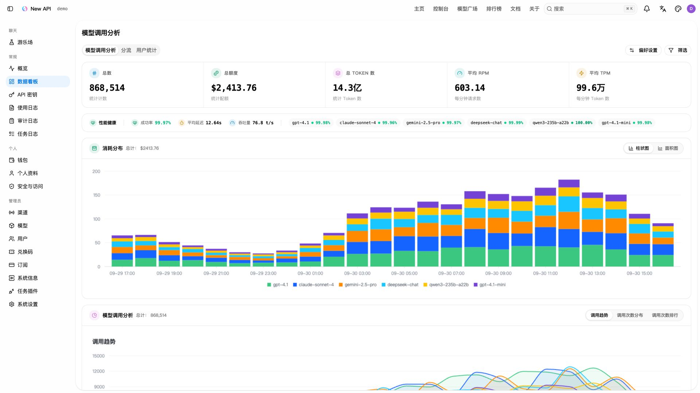
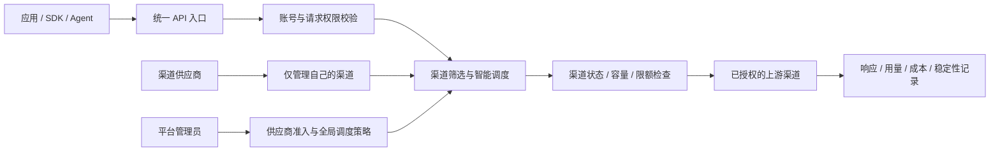
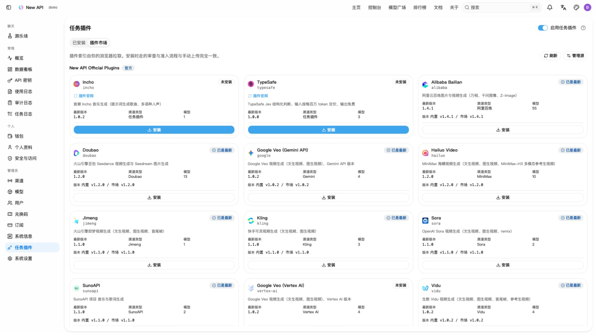
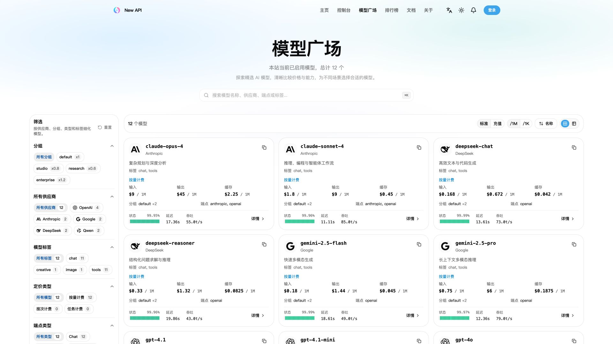
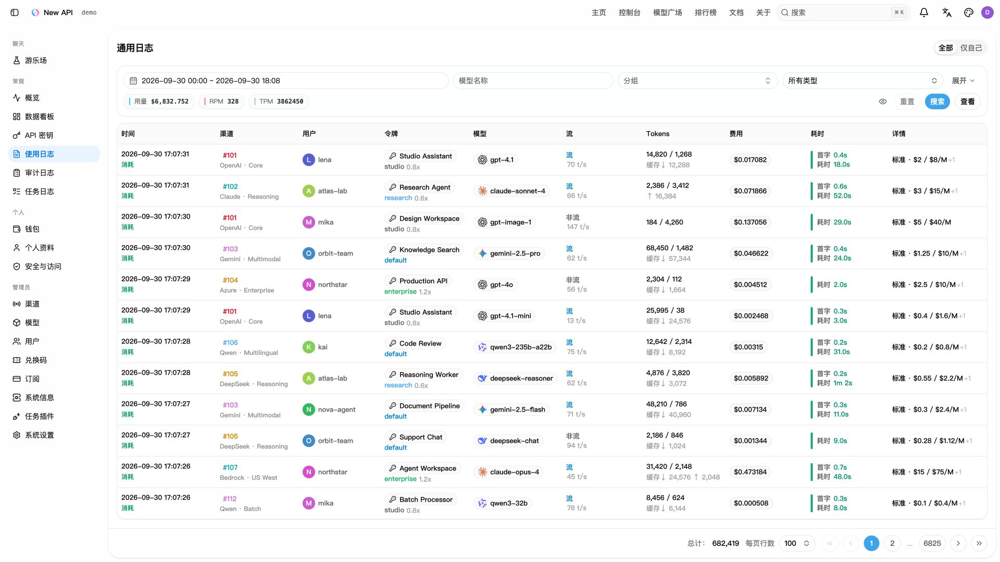

<div align="center">

# SmartRouter-v2 · 智能路由

**统一模型入口，智能分配流量，隔离供应商数据。**

<p>
  <a href="./go.mod"></a>
  <a href="./web/package.json"></a>
  <a href="./web/package.json"></a>
  <a href="./Dockerfile"></a>
  <a href="./LICENSE"></a>
</p>

[](https://github.com/d100000/SmartRouter-v2/commit/c6befee165a7a8c2f4a4a0f2278b684c01f1f409)
[main 最新提交](https://github.com/d100000/SmartRouter-v2/commits/main/)

**当前功能版本：`c6befee16` · 功能提交时间：2026-11-09 02:08:50（北京时间 / UTC+8）**

<p>
  <a href="#sr-start"></a>
  <a href="https://github.com/d100000/SmartRouter-v2/archive/refs/heads/main.zip"></a>
  <a href="#sr-suppliers"></a>
</p>

[功能介绍](#sr-purpose) · [渠道限额](#sr-channel-limits) · [本地开发](#sr-development) · [来源与许可证](#sr-upstream)

</div>

SmartRouter-v2 是一个可自行部署的 AI 网关，面向需要管理多个上游渠道、运营模型服务或与外部供应商协作的团队。应用通过统一 API 使用模型，平台负责权限校验、渠道选择、用量记录与额度控制；供应商在独立工作台维护自己的供货渠道。

<p align="center">
  <a href="./assets/screenshots/dashboard.zh-CN.jpg"></a>
  <br>
  <sub>基于 New API 的控制台预览（演示数据）</sub>
</p>

本项目基于 [new-api](https://github.com/QuantumNous/new-api) 开发，保留其模型接入与管理基础，重点扩展自适应渠道调度。原项目署名、许可与说明保留在[文末](#sr-upstream)。

<a id="sr-purpose"></a>

## 功能介绍

| 能力 | 可以做什么 |
| --- | --- |
| 统一模型入口 | 接入 OpenAI Chat / Responses、Anthropic Messages、Gemini，以及受支持的图像、音频、Embedding 和 Rerank 接口 |
| 自适应渠道路由 | 结合渠道成功表现、首输出延迟与当前负载分配流量，提供冷启动、故障降权、受控重试和容量保护 |
| 供应商工作台 | 管理员创建供应商账号；供应商维护自己的渠道、模型、启停、内部优先级，并查看自己的供货数据 |
| 渠道查看员 | 在普通用户能力上增加全渠道非秘密信息只读权限，保留本人 API Key、调用及个人账户能力 |
| 渠道用量限额 | 按渠道设置 RPM、TPM 和每日采购成本预算；管理员管理全部渠道，供应商管理本人渠道 |
| 异步与实时调用 | 接入受支持的任务插件、Midjourney/SwapFace 任务，以及 Responses WebSocket 和 Realtime 的逐次调用控制 |
| 运营与成本观察 | 查看渠道用量、缓存统计、采购成本、稳定性、任务状态、预算事件及脱敏日志，区分真实用量与未知结果 |
| 平台管理 | 沿用用户、分组、配额、订阅、模型计价、审计和账号安全能力，提供渠道欠费监控与恢复管理 |

接口可用性取决于上游模型、渠道类型和已启用的模板或插件。协议转换不意味着所有上游专有字段、工具调用或多模态能力都可以无损互通。

<a id="sr-routing"></a>

## 请求如何到达上游



应用选择要调用的模型，SmartRouter-v2 为这个模型选择可用渠道。调度过程先满足分组、模型、协议、供货状态和请求策略，再结合近期成功率、首输出延迟与负载调整流量。

- **逐步学习**：新渠道从受限流量开始积累样本，在有健康替代渠道时控制试探流量。
- **故障回退**：符合重试条件且响应尚未开始时，尝试其他合格渠道；不会在已输出内容后自动重放整个请求。
- **容量保护**：同一实例内可为共用上游账号的渠道配置共享容量池，限制同时派发量。
- **分层优先级**：管理员控制供应商池及平台全局调度；供应商调整的优先级只作用于自己的渠道池。

<a id="sr-suppliers"></a>

## 供应商与权限

供应商身份用于供货，渠道查看员用于观察渠道。两者拥有不同的工作范围。

授予渠道查看权限：先创建普通用户，再在用户列表的行菜单中选择“授予渠道查看权限”，按提示完成身份验证。

| 操作 | 普通用户 | 渠道查看员 | 渠道供应商 | 平台管理员 |
| --- | --- | --- | --- | --- |
| 本人 API Key、模型调用与个人账户 | 按现有规则 | 保留普通用户全部能力 | 专用供货账号不提供消费者能力 | 按现有规则 |
| 查看渠道非秘密信息 | 不提供全渠道查看 | 全部渠道，只读 | 仅本人渠道 | 按管理员权限 |
| 创建、修改、暂停渠道 | 不允许 | 不允许 | 仅本人渠道及获授权配置 | 按管理员权限 |
| 调整供应商内部优先级 | 不允许 | 不允许 | 仅本人渠道池 | 允许 |
| 配置平台全局调度优先级 | 不允许 | 不允许 | 不允许 | 允许 |
| 设置渠道 RPM、TPM、每日预算 | 不允许 | 不允许 | 仅本人渠道 | 全部渠道 |
| 查看供应商供货日志及导出 | 不允许 | 不额外授予 | 仅本人的脱敏记录 | 按管理员权限 |
| 回读受保护的上游渠道 Key | 不允许 | 不允许 | 不允许 | 不允许 |

供应商 A 看不到供应商 B 的渠道、请求日志、统计、筛选项或历史明细。隔离由后端执行，历史数据按照调用时的供应商归属快照展示，不根据当前渠道归属重新分配。

供应商可查看本人渠道的日采购预算、已用、预占和剩余金额；这不开放客户售价、平台收入、利润、其他用户身份或请求内容。渠道查看员可以管理自己的消费 Key，但不能读取上游渠道 Key，也不能借只读权限获得跨用户请求日志。

受保护凭据通过 HTTPS 提交、加密保存，管理接口不返回明文；复制渠道或变更归属不会解除只写保护。平台仍需在发起上游请求时使用凭据完成认证。

<a id="sr-channel-limits"></a>

## 渠道 RPM、TPM 与每日预算

三项限制独立配置，**未设置或关闭即表示该项不限**。供应商可调整自己渠道的三项限额，不能解除管理员的供货禁用。

| 限额 | 统计口径 | 恢复规则 |
| --- | --- | --- |
| RPM | 实际发往上游的业务推理请求或任务提交次数；真实重试也计入 | 滚动 60 秒窗口释放后重新参与准入 |
| TPM | 适用协议的文本输入与输出 Token，采用发送前预占和可信用量校正 | 占用释放后重新参与准入；无文本 Token 语义的模板不虚构 Token 用量 |
| 每日采购成本预算 | 平台记录的渠道采购成本，使用 USD；已用与在途预占共同参与准入检查 | 当日耗尽后停止新调用，次日北京时间 00:00 解除日预算限制 |

同一渠道的计数由全部模型、Key、客户分组和网关实例共享。不同渠道分别计数，渠道预算不等于供应商总预算或共享上游账号限额。

**零点只解除日预算限制。** 手动暂停、管理员停供、健康异常、营业时间及分钟限流等条件仍然有效；修改限额不会清零已有用量。跨日请求继续归属原预算日，客户退款不会直接减少采购成本。

已发送的请求和已提交的任务继续完成，WebSocket 中的新生成请求重新检查限额。任务轮询与结果下载不重复消耗业务 RPM。未知用量和成本保留为未知或保守预占，不按零处理；迟到结果按原记录校正。

启用日预算前需要有效的采购成本规则。平台核算采购成本可能是估算值，不等同于上游最终账单；并发预占降低超支风险，但不能保证上游最终账单绝不超出预算。

<a id="sr-console"></a>

## 控制台与运营观察

| 页面 | 用途 |
| --- | --- |
| 调度中心 | 查看分组与模型的近期表现、渠道权重、首输出延迟、冷却和容量占用，配置路由策略 |
| 渠道概览 | 查看渠道调用、用量、缓存及成本数据，按现有统计维度比较运营表现 |
| 供应商管理 | 创建供应商身份，设置授权范围、供货状态和平台池策略，识别渠道所属供应商 |
| 供应商工作台 | 维护本人渠道、模型验证、内部排序、限额，并查看本人概览、稳定性及供货日志 |
| 日志与审计 | 查看获授权的调用记录、异常状态和管理事件；供应商只获得允许的脱敏字段 |

异步任务的“提交成功”和“任务完成成功”分别记录；完成状态、耗时和媒体用量取决于可核验的上游结果。实时连接建立成功也不代表后续生成成功，每次新生成独立执行准入与计量。

<a id="sr-start"></a>

## 快速开始：部署与接入

### 从本仓库构建 Docker 镜像

要使用本分支的智能路由功能，请构建本仓库源码。仓库原有 `docker-compose.yml` 仍默认使用上游 `calciumion/new-api:latest` 镜像，该镜像不能视为包含本分支功能的发布产物。

以下命令适合首次在本机体验，使用 SQLite，并将数据保存在仓库外的 `smartrouter-v2-data/`。需要 Git、Docker 和 OpenSSL：

```bash
git clone https://github.com/d100000/SmartRouter-v2.git
cd SmartRouter-v2

# 把持久配置放在仓库之外，已有文件保持不变
SMARTROUTER_ENV_FILE="$(pwd)/../smartrouter-v2.env"
SMARTROUTER_DATA_DIR="$(pwd)/../smartrouter-v2-data"
if [ ! -e "$SMARTROUTER_ENV_FILE" ]; then
  (
    umask 077
    set -C
    printf 'SESSION_SECRET=%s\n' "$(openssl rand -hex 32)" > "$SMARTROUTER_ENV_FILE"
  )
fi

# 将本次 Git 版本写入前端构建信息
docker build \
  --build-arg VITE_PROJECT_VERSION="$(git rev-parse --short=9 HEAD)" \
  --build-arg VITE_PROJECT_VERSION_DATE="$(git show -s --format=%cI HEAD)" \
  -t smartrouter-v2:local .

mkdir -p "$SMARTROUTER_DATA_DIR"
docker run --name smartrouter-v2 -d --restart unless-stopped \
  -p 127.0.0.1:3000:3000 \
  --env-file "$SMARTROUTER_ENV_FILE" \
  -e TZ=Asia/Shanghai \
  -v "$SMARTROUTER_DATA_DIR:/data" \
  smartrouter-v2:local
```

打开 [http://localhost:3000](http://localhost:3000)，通过初始化向导设置管理员账号。管理员密码由你在首次初始化时设置，不依赖预置的通用密码。已有实例升级前请备份数据库和密钥配置，继续使用已有的 `smartrouter-v2.env`。配置文件和业务数据均位于仓库外，不进入 Docker 构建上下文；环境配置文件首次创建时仅当前用户可读写。

### 发出第一条请求

1. 在控制台添加渠道，配置上游地址、凭据、模型和分组，并测试可用性。
2. 设置模型价格及用户可用额度，创建消费 API Key。
3. 将客户端 Base URL 指向 `http://localhost:3000/v1`，填写自己的 Key。
4. 为同一模型接入多个渠道后，在调度中心按实际供货能力设置容量与策略，观察真实调用结果。

将下面的模型名称替换成已启用的模型，并在当前终端设置 `SMARTROUTER_API_KEY`：

```bash
curl --fail-with-body http://localhost:3000/v1/chat/completions \
  -H "Authorization: Bearer ${SMARTROUTER_API_KEY}" \
  -H "Content-Type: application/json" \
  -d '{"model":"your-enabled-model","messages":[{"role":"user","content":"Hello!"}],"stream":true}'
```

### 启用供应商供货

管理员先在“渠道供应商”中配置授权模板、可用模型和必要的采购成本规则，再到用户管理创建“渠道供应商”账号并选择对应供应商。供应商首次登录须完成强制改密，之后提交渠道配置并按协议完成模型验证；异步模型需要确认任务成功终态，不能只以接收成功放行。

供应商凭据提交要求 **HTTPS、Secure 会话 Cookie 和已配置的加密密钥环**。上述本机 HTTP 示例可用于一般控制台体验，不会绕过供应商凭据提交的传输保护。正式接入供应商时，请为实例配置 HTTPS 入口并检查反向代理设置。

## 部署配置

| 配置 | 说明 |
| --- | --- |
| `SQL_DSN` | 主数据库连接串；支持 SQLite、MySQL ≥ 5.7.8、PostgreSQL ≥ 9.6；未设置时使用 SQLite |
| `LOG_SQL_DSN` | 可选的独立日志数据库连接串，日志库额外支持 ClickHouse |
| `REDIS_CONN_STRING` | Redis 连接串；Redis 的启用不改变智能路由容量池的单实例边界 |
| `SESSION_SECRET` | 持久化的会话密钥；多实例应按部署方案保持一致 |
| `SUPPLIER_CREDENTIAL_KEYS` | 供应商凭据加密密钥环，JSON 对象；每个版本的值是 Base64 编码的随机 32 字节密钥 |
| `SUPPLIER_CREDENTIAL_ACTIVE_KEY` | 当前用于新凭据加密的密钥版本，必须存在于密钥环中 |
| `SESSION_COOKIE_SECURE` | HTTPS 部署时设为 `true`，并同时配置 `SESSION_COOKIE_TRUSTED_URL`；供应商凭据提交要求安全会话 |
| `SESSION_COOKIE_TRUSTED_URL` | 按鉴权文档配置允许的准确 HTTPS 浏览器来源 |
| `TRUSTED_PROXIES` | 明确列出可信反向代理 IP/CIDR；代理应覆盖真实的 `X-Forwarded-Proto`，不能信任客户端伪造值 |

密钥环示意，尖括号内容需要替换为实际生成的秘密：

```dotenv
SUPPLIER_CREDENTIAL_KEYS={"v1":"<base64-encoded-32-byte-secret>"}
SUPPLIER_CREDENTIAL_ACTIVE_KEY=v1
```

可使用 `openssl rand -base64 32` 生成一个密钥版本。密钥环由部署方独立保管，不写入业务数据库、公开仓库或日志；轮换时保留所有仍被现存密文引用的旧版本；切换活动版本不会自动重加密已有渠道、草稿和任务快照，完成迁移并核实无引用后才能删除旧版本。数据库备份不能替代加密密钥备份。

完整配置见 [.env.example](./.env.example) 与[鉴权及登录会话说明](./docs/authentication.md)。反向代理还需支持流式输出和 WebSocket 升级。使用 [Compose 配置](./docker-compose.yml) 部署时，应将应用镜像替换为本仓库构建的镜像，并设置实际数据库连接和秘密。

<a id="sr-limits"></a>

## 当前能力边界

- **渠道调度**：依据调用表现选择已指定模型的渠道，不分析提示词来自动选择模型，也不评判回答质量或承诺固定 SLA。
- **实例协调**：智能调度学习、冷却和共享容量池在当前实例内运行；渠道 RPM、TPM、日预算通过持久化许可与账本在使用同一主库的实例间协调。两者不是同一种容量限制。
- **协议覆盖**：供应商只能使用已开放并通过验证的模板。部分依赖来源素材的异步动作需要相应上下文，不能把所有插件和上游动作视为可自动验证。
- **统计可信度**：没有流量或缺少可信用量时显示缺失或未知；不将请求预估当作真实完成量，也不将采购估算表述为厂商结算账单。
- **角色范围**：首期供应商采用专用账号，不提供供应商自助注册、多员工组织或消费者/供应商双身份切换；采购预算不是供应商付款结算系统。

供应商权限、限额和恢复规则的详细定义见[渠道供应商产品规划](./design-plans/channel-supplier-role-product-plan.md)。调度背景见 [SCHEDULING.md](./SCHEDULING.md)；其中部分算法细节仍需结合当前源码核对。

<a id="sr-development"></a>

## 本地开发

后端使用 Go、Gin 和 GORM；前端使用 React 19、TypeScript、Rsbuild、TanStack、Base UI 与 Tailwind CSS 4。根模块的 Go 版本见 [go.mod](./go.mod)，当前为 Go 1.26.10；前端使用 Bun 1.4.4，依赖版本以仓库文件为准。

```bash
# 先构建后端需要嵌入的前端资源
cd web
bun install --frozen-lockfile
bun run build
cd ..

go run .
```

需要前端热更新时，在另一个终端执行：

```bash
cd web
bun run dev -- --host 127.0.0.1 --port 5173
```

访问 [http://localhost:5173](http://localhost:5173)，开发服务器默认将 API 请求代理到 `http://localhost:3000`。也可通过 `make dev-api` 启动源码构建的 PostgreSQL / Redis 开发栈。前端构建需要先于根模块的构建或测试完成，避免嵌入资源在构建期间被清理。

| 目录 | 职责 |
| --- | --- |
| `controller/`、`middleware/`、`router/` | 管理 API、访问校验与路由 |
| `service/`、`model/` | 调度接入、任务处理、数据模型、供应商与渠道许可账本 |
| `pkg/scheduler/` | 调度窗口、评分、容量与恢复策略 |
| `relay/` | 上游请求与响应处理 |
| `relaykit/`、`tokenkit/` | 独立的协议转换及 Token 计数模块 |
| `web/` | 管理控制台、供应商工作台与用户界面 |
| `plugins/tasks/` | JavaScript 异步任务插件 |

## 参与贡献

提交变更前请阅读 [AGENTS.md](./AGENTS.md)；修改前端时同时阅读 [web/AGENTS.md](./web/AGENTS.md)。只提交与当前任务相关的文件，并为权限、计量、账本和协议行为提供对应验证。

常用检查：

```bash
# 根目录，已先完成前端构建
go test ./...
go build ./...

# web/ 目录
bun run lint
bun run typecheck
bun run test
bun run build
```

`relaykit/` 与 `tokenkit/` 保持独立构建；改动对应模块时，在各自目录执行 `GOWORK=off go test ./...` 和 `GOWORK=off go build ./...`。涉及数据库行为的变更，还需按项目约定验证 SQLite、MySQL 和 PostgreSQL。

[提交问题](https://github.com/d100000/SmartRouter-v2/issues) · [发起 Pull Request](https://github.com/d100000/SmartRouter-v2/pulls) · [查看更新](https://github.com/d100000/SmartRouter-v2/commits/main/)

<a id="sr-upstream"></a>

## 上游来源与许可证

SmartRouter-v2 基于 **new-api / QuantumNous** 开发，遵循 [AGPLv3](./LICENSE) 及 [NOTICE](./NOTICE) 中的附加条款。原项目标识、作者署名和第三方声明予以保留，依赖许可见 [THIRD-PARTY-LICENSES.md](./THIRD-PARTY-LICENSES.md)。

下面完整保留上游原始 README。其截图、合作伙伴、发布渠道和镜像说明属于上游项目；部署本分支请使用上方“部署与接入”的构建方式。

<details>
<summary>展开上游 New API 原始说明、署名与许可信息</summary>

<div align="center">


# New API

**连接模型、应用与 Agent 的 AI 网关**

<p align="center">
  <strong>简体中文</strong> |
  <a href="./README.zh_TW.md">繁體中文</a> |
  <a href="./README.md">English</a> |
  <a href="./README.fr.md">Français</a> |
  <a href="./README.ja.md">日本語</a>
</p>

<p align="center">
  <a href="https://raw.githubusercontent.com/Calcium-Ion/new-api/main/LICENSE">
    
  </a><!--
  --><a href="https://github.com/Calcium-Ion/new-api/releases/latest">
    
  </a><!--
  --><a href="https://hub.docker.com/r/CalciumIon/new-api">
    
  </a>
  <a href="https://atomgit.com/QuantumNous/new-api" target="_blank">
    
  </a>
</p>

<p align="center">
  <a href="https://trendshift.io/repositories/20180" target="_blank">
    
  </a>
  <br>
  <a href="https://hellogithub.com/repository/QuantumNous/new-api" target="_blank">
    
  </a><!--
  -->
  <a href="https://atomgit.com/QuantumNous/new-api" target="_blank">
    
  </a>
</p>

<p align="center">
  <a href="#screenshots">项目截图</a> •
  <a href="#capabilities">核心能力</a> •
  <a href="#quick-start">快速开始</a> •
  <a href="#deployment">部署运维</a> •
  <a href="#development">开发扩展</a> •
  <a href="#documentation">文档社区</a>
</p>

</div>

---

## 📝 项目说明

New API 是面向应用、Agent 和团队的自托管 AI 网关。将不同厂商的模型服务接入统一入口，在同一套控制台中管理渠道、访问权限、用量与成本。

你可以用它为团队分配已授权的模型资源，在切换上游时减少客户端改动，或搭建自己的多模型服务。支持接入 OpenAI、Anthropic、Google Gemini、Azure OpenAI、AWS Bedrock、Vertex AI、DeepSeek、通义千问及其他兼容服务。

> [!IMPORTANT]
> - 本项目仅面向合法授权的 AI API 网关、组织内部鉴权、多模型管理、用量统计、成本核算和私有化部署场景。
> - 使用者必须合法取得上游 API Key、账号、模型服务或接口权限，并遵守上游服务条款及适用法律法规。
> - 使用者应确保其使用方式符合上游服务条款及适用法律法规。
> - 面向公众提供生成式人工智能服务时，使用者应遵守[《生成式人工智能服务管理暂行办法》](http://www.cac.gov.cn/2023-07/13/c_1690898327029107.htm)等监管要求，自行完成所在司法辖区要求的备案、许可、内容安全、实名、日志留存、税务和上游授权等合规义务。

<!-- -->

> [!WARNING]
> 将本项目作为面向公众的生成式 AI 服务或 API 转售服务运营时，使用者应先完成备案、内容安全、实名、日志留存、税务、支付和上游授权等合规义务。

---

<a id="screenshots"></a>

## 项目截图

以下账号、渠道、插件安装状态、用量、价格和费用均为模拟数据，插件市场展示官方目录。点击图片可查看原图。

| 数据看板 | 插件市场 |
| --- | --- |
| [](assets/screenshots/dashboard.zh-CN.jpg) | [](assets/screenshots/plugin-marketplace.zh-CN.jpg) |
| **模型广场** | **使用日志** |
| [](assets/screenshots/models.zh-CN.jpg) | [](assets/screenshots/usage-logs.zh-CN.jpg) |

---

## 🤝 我们信任的合作伙伴

<p align="center">
  <em>排名不分先后</em>
</p>

<p align="center">
  <a href="https://www.cherry-ai.com/" target="_blank">
    
  </a><!--
  --><a href="https://github.com/iOfficeAI/AionUi/" target="_blank">
    
  </a><!--
  --><a href="https://bda.pku.edu.cn/" target="_blank">
    
  </a><!--
  --><a href="https://www.aliyun.com/" target="_blank">
    
  </a><!--
  --><a href="https://io.net/" target="_blank">
    
  </a>
</p>

---

## 🙏 特别鸣谢

<p align="center">
  <a href="https://www.jetbrains.com/?from=new-api" target="_blank">
    
  </a>
</p>

<p align="center">
  <strong>感谢 <a href="https://www.jetbrains.com/?from=new-api">JetBrains</a> 为本项目提供免费的开源开发许可证</strong>
</p>

---

<a id="capabilities"></a>

## 核心能力

| 方向 | 可以做什么 |
| --- | --- |
| 模型接入 | 支持 OpenAI Chat Completions、Responses、Anthropic Messages 和 Gemini 协议，以及上游支持的流式输出、工具调用、推理与多模态输入 |
| 渠道调度 | 配置模型映射、渠道优先级与权重、失败重试、渠道亲和性和多密钥管理 |
| 用量与成本 | 管理额度、订阅套餐、用量日志、缓存计费，以及基于表达式的阶梯定价 |
| 访问控制 | 管理用户、分组、细粒度权限和 API Key 限制；支持 OAuth/OIDC、通行密钥、两步验证与登录会话管理 |
| 异步任务 | 通过 JavaScript 插件扩展图片、视频等任务 API，统一查询任务状态和获取产物 |
| Web 控制台 | 配置渠道与模型、查看用量和审计日志、在 Playground 中调试模型；支持简体中文、繁体中文、英语、法语、日语、俄语和越南语 |

### 协议与接口

| 接口类型 | 常用入口 |
| --- | --- |
| OpenAI Chat / Responses | `POST /v1/chat/completions`、`POST /v1/responses` |
| Anthropic Messages | `POST /v1/messages` |
| Gemini | `POST /v1beta/models/{model}:generateContent`、`POST /v1beta/models/{model}:streamGenerateContent` |
| Realtime / Responses WebSocket | `GET /v1/realtime`、`GET /v1/responses`（WebSocket 升级） |
| 图片 / 音频 | `/v1/images/generations`、`/v1/images/edits`、`/v1/audio/speech`、`/v1/audio/transcriptions`、`/v1/audio/translations` |
| 向量 / 重排 | `POST /v1/embeddings`、`POST /v1/rerank` |
| 任务插件 | `POST /v1/tasks/{pluginKey}`、`GET /v1/tasks/{taskId}`，以及各插件声明的协议路由 |

[RelayKit](./relaykit/README.md) 提供上述四种文本协议之间的请求、响应和流式转换。实际可用能力取决于渠道、上游模型和转换路径；协议特有的工具与字段可能无法完整映射。WebSocket 同样需要上游与渠道配置支持。

本 README 描述当前源码的能力，部署时请同时查看所选版本的发布说明。

<a id="quick-start"></a>

## 快速开始

### 使用 Docker 本地体验

以下命令使用 SQLite 启动单实例，仅监听本机端口：

```bash
mkdir -p data
docker run --name new-api -d --restart unless-stopped \
  -p 127.0.0.1:3000:3000 \
  -e TZ=Asia/Shanghai \
  -v "$(pwd)/data:/data" \
  calciumion/new-api:latest
```

打开 [http://localhost:3000](http://localhost:3000)，按初始化向导创建管理员账号。SQLite 数据库存放在挂载的 `data` 目录中，更换容器后仍会保留。

### 发起第一次请求

1. 新建渠道，填写上游 API Key、可用模型和所属分组，执行渠道测试。
2. 配置模型价格，确保调用用户有可用额度或有效订阅。
3. 在控制台创建 API Key，确保它能访问对应分组和模型。
4. 对于 OpenAI 兼容客户端，将 Base URL 设为 `http://localhost:3000/v1`，密钥使用 **New API 签发的 Key**。

在终端中将 `NEW_API_KEY` 环境变量设为该密钥，查询它可以访问的模型：

```bash
curl --fail-with-body http://localhost:3000/v1/models \
  -H "Authorization: Bearer ${NEW_API_KEY}"
```

然后调用 Responses，将 `your-enabled-model` 替换为已启用且支持该接口的模型名称：

```bash
curl --fail-with-body http://localhost:3000/v1/responses \
  -H "Authorization: Bearer ${NEW_API_KEY}" \
  -H "Content-Type: application/json" \
  -d '{"model":"your-enabled-model","input":"Hello!"}'
```

<a id="deployment"></a>

## 部署与运维

### Docker Compose

仓库的 [Compose 配置](./docker-compose.yml) 默认启动 **New API + PostgreSQL + Redis**，并提供 MySQL 和独立 ClickHouse 日志库的配置示例。

```bash
git clone https://github.com/QuantumNous/new-api.git
cd new-api
```

启动前编辑 `docker-compose.yml`：同时替换数据库、Redis 服务及对应连接串中的示例密码，并设置固定的随机 `SESSION_SECRET`（可用 `openssl rand -hex 32` 生成）。通过 HTTPS 访问控制台时，设置 `SESSION_COOKIE_SECURE=true`，并在 `SESSION_COOKIE_TRUSTED_URL` 中填写控制台对外的精确 HTTPS Origin。

```bash
docker compose up -d
docker compose logs -f new-api
```

### 存储与配置

| 组件 | 可选方案 |
| --- | --- |
| 主数据库 | SQLite、MySQL ≥ 5.7.8、PostgreSQL ≥ 9.6 |
| 独立日志库 | 通过 `LOG_SQL_DSN` 配置，额外支持 ClickHouse |
| 缓存 | 可选 Redis 与内存缓存；多节点需要共享限流额度时使用共享 Redis |
| 容器平台 | Linux amd64 / arm64 |

| 环境变量 | 用途 |
| --- | --- |
| `SQL_DSN` | 主数据库连接串；未设置时使用 SQLite |
| `LOG_SQL_DSN` | 可选的独立日志数据库连接串 |
| `REDIS_CONN_STRING` | Redis 连接串 |
| `SESSION_SECRET` | 持久保存的鉴权密钥，所有节点必须一致 |
| `CRYPTO_SECRET` | 默认使用 `SESSION_SECRET`；共享 Redis 的节点必须使用相同的有效值 |
| `SESSION_COOKIE_SECURE` | HTTPS 控制台设为 `true`，启用 Secure 刷新 Cookie 和严格的刷新／退出来源校验 |
| `SESSION_COOKIE_TRUSTED_URL` | Secure 模式必填：以逗号分隔的精确 HTTPS Origin，不含路径或通配符；本地 HTTP 模式不设置 |
| `TRUSTED_PROXIES` | 可信反向代理 IP/CIDR，或 `none`；按实际网络显式配置 |

完整配置见[环境变量示例](./.env.example)、[环境变量文档](https://docs.newapi.ai/zh/docs/installation/config-maintenance/environment-variables)和[鉴权与登录会话说明](./docs/authentication.md)。容器变量应通过 Compose 的 `environment` 或 `env_file` 注入；只复制 `.env.example` 不会自动将变量传入容器。

正式部署时使用 HTTPS，并配置反向代理支持流式响应与 WebSocket 升级。持久化并备份数据库和挂载数据。多节点必须共用主数据库和鉴权密钥；独立 Redis 或内存限流器会按节点分别计数。不同拓扑下的会话传播行为见鉴权文档。

从[发布页](https://github.com/QuantumNous/new-api/releases)选择明确的镜像版本，阅读升级说明并先备份再升级。`latest` 会随发布构建变化；已有实例应按实际版本评估迁移与兼容性。

<a id="development"></a>

## 开发与扩展

后端使用 Go 和 Gin；控制台使用 React 19、TypeScript、Rsbuild、TanStack 与 Tailwind CSS 4。前端依赖和脚本使用 Bun；Go 语言基线见 [go.mod](./go.mod)，容器构建工具链见 [Dockerfile](./Dockerfile)。

后端会嵌入 `web/dist`，首次启动前先构建前端：

```bash
# 仓库根目录
cd web
bun install --frozen-lockfile
bun run build
cd ..
go run .
```

在另一个终端启动前端开发服务器：

```bash
cd web
bun run dev -- --port 5173
```

访问 [http://localhost:5173](http://localhost:5173)，开发服务器会将 API 请求代理到 3000 端口的后端。需要容器化开发后端时，参阅 [docker-compose.dev.yml](./docker-compose.dev.yml) 和 [makefile](./makefile) 中的 `make dev`。

| 目录 | 职责 |
| --- | --- |
| `router/`、`middleware/`、`controller/` | HTTP 路由、访问校验与 API 处理 |
| `relay/` | 上游适配与请求调度 |
| `service/`、`model/` | 业务逻辑与持久化 |
| [relaykit/](./relaykit/README.md) | 可独立构建的协议 DTO 与转换 Go 模块 |
| [plugins/tasks/](./plugins/tasks/) | JavaScript 任务插件；编写方式与宿主边界见 [Task Plugin API v1](./docs/plugin-api/v1.md) |
| `web/` | Web 控制台，参阅[前端开发约定](./web/AGENTS.md) |
| [electron/](./electron/README.md) | 桌面封装与打包 |

贡献前请阅读 [AGENTS.md](./AGENTS.md)。按改动范围执行检查：Go 模块使用 `make test`；前端在 `web/` 下运行 `bun check -b`、`bun run lint`、`bun run test` 和 `bun run build`。修改 RelayKit 后还必须在 `relaykit/` 下执行 `GOWORK=off go build ./...`。

<a id="documentation"></a>

## 文档与社区

| 资源 | 入口 |
| --- | --- |
| 官方文档 | [使用指南](https://docs.newapi.ai/zh/docs) · [安装部署](https://docs.newapi.ai/zh/docs/installation) · [API 参考](https://docs.newapi.ai/zh/docs/api) |
| 项目导读 | [DeepWiki](https://deepwiki.com/QuantumNous/new-api) |
| 使用问题与交流 | [常见问题](https://docs.newapi.ai/zh/docs/support/faq) · [社区渠道](https://docs.newapi.ai/zh/docs/support/community-interaction) |
| 缺陷与功能建议 | [GitHub Issues](https://github.com/QuantumNous/new-api/issues) |
| 安全漏洞 | 按[安全政策](./.github/SECURITY.md)进行私下报告 |

反馈问题时请附上版本、部署方式、复现步骤及脱敏日志。欢迎贡献文档、翻译、渠道适配和有针对性的回归测试。

---

## 🔗 相关项目

### 上游项目

| 项目 | 说明 |
|------|------|
| [One API](https://github.com/songquanpeng/one-api) | 原版项目基础 |
| [Midjourney-Proxy](https://github.com/novicezk/midjourney-proxy) | Midjourney 接口支持 |

### 配套工具

| 项目 | 说明 |
|------|------|
| [new-api-key-tool](https://github.com/Calcium-Ion/new-api-key-tool) | Key 额度查询工具 |
| [new-api-horizon](https://github.com/Calcium-Ion/new-api-horizon) | New API 高性能优化版 |

---

## 📜 许可证

本项目采用 [GNU Affero 通用公共许可证 v3.0 (AGPLv3)](./LICENSE) 授权。

根据 AGPLv3 第 7 条，本项目还适用[附加条款](./NOTICE)。修改版本必须在适当法律声明及界面中显著的关于、法律、页脚或署名位置保留作者署名 `Frontend design and development by New API contributors.`，并保留指向原项目 <https://github.com/QuantumNous/new-api> 的可见链接。

本项目为开源项目，在 [One API](https://github.com/songquanpeng/one-api)（MIT 许可证）的基础上进行二次开发。

如果您所在的组织政策不允许使用 AGPLv3 许可的软件，或您希望规避 AGPLv3 的开源义务，请发送邮件至：[support@quantumnous.com](mailto:support@quantumnous.com)

署名及依赖声明见 [NOTICE](./NOTICE) 和[第三方许可证](./THIRD-PARTY-LICENSES.md)。

---

## 🌟 Star History

<div align="center">

[](https://star-history.com/#Calcium-Ion/new-api&Date)

</div>

---

<div align="center">

### 💖 感谢使用 New API

如果这个项目对你有帮助，欢迎给我们一个 ⭐️ Star！

**[官方文档](https://docs.newapi.ai/zh/docs)** • **[问题反馈](https://github.com/Calcium-Ion/new-api/issues)** • **[最新发布](https://github.com/Calcium-Ion/new-api/releases)**

<sub>Built with ❤️ by QuantumNous</sub>

</div>

</details>
