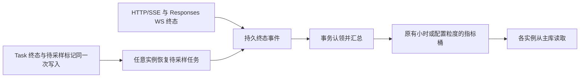

# 模型稳定性预设配置与监控优化需求文档

日期：2026 年 10 月 27 日

版本：2.0

状态：第一、二阶段已在工作区实现，等待部署验收；第三阶段待实施

审查基线：08ab5282a83f21a164ea409ca6c2173f98e94772

适用页面：/dashboard/reliability

本轮目标是让管理员首次进入就能看到 Kimi、Openai、Claude 及其已知模型归属，并分清“暂无请求”“模型未归属”“指标尚未接入”和“采集故障”。先完成预设与配置闭环、修正展示与统计问题，再建设尝试级遥测和可靠存储。

当前已接入真实性能数据及公司配置 API，旧版文档“只实现静态 demo”的描述不再适用。第 1–14 节保留需求评审时的证据和基线；第一阶段的实现记录见第 15 节，第二阶段的实现、验证和部署注意事项见第 16 节。本轮未修改线上数据。

## 1. 需求与范围

| 来源 | 需求 | 交付要求 |
| --- | --- | --- |
| 用户明确提出 | 预设 Kimi、Openai、Claude | 默认可用，兼容已有同义公司和历史 ID |
| 用户明确提出 | 预设模型提前加入公司 | 精确预设成员提前建立归属，不等第一次调用后逐个填写 |
| 用户明确提出 | 汇总此前线上排查问题 | 记录证据、影响、处理要求与验证方法 |
| 用户明确提出 | 系统 review 模型稳定性 | 覆盖配置闭环、指标正确性、数据可靠性、页面体验和上线验收 |
| 本文建议 | 扩展可预设配置 | 默认值有来源、可编辑、有明确覆盖优先级 |

本期围绕“查看稳定性 → 找到异常模型 → 确认归属 → 调整监控配置 → 验证保存”展开。模型研发品牌、实际渠道、监控模型组和业务计费分组分别表达。

预设不会自动请求上游，不产生探测费用；不修改密钥、渠道模型、重定向、调度权重、价格或结算。外部通知、主动探测、回答质量评测和成本分析作为后续独立范围。

## 2. 已验证现状

### 2.1 线上检查快照

2026 年 10 月 27 日对 Docker 部署和已登录页面检查得到：

| 项目 | 观察结果 | 结论 |
| --- | --- | --- |
| 应用 | 3003 端口对应 smartrouter2-app，镜像 smartrouter-v2:f0f5600 | 使用自建镜像；标签本身不能证明源码提交 |
| 数据库 | MySQL 8.2.0；871 个性能桶、8 个模型、累计 227,695 次请求 | 基础采集和历史落库已有数据 |
| 页面 14:54 快照 | 近窗口 122,080 次请求、97.96% 最终成功率，平均延迟和 TPS 有值 | 页面并非完全没有数据 |
| 公司配置 | 已保存 Openai，没有模型组和成员 | 8 个模型全部未归属，选择 Openai 后为空 |
| 缺失项 | 首次成功、重试、P95、错误分类等“尚未采集” | 当前采集或接口未接入，不能通过 Docker 开关补出 |

数值是检查时快照，不是固定验收结果。当前窗口按小时对齐，跨小时后请求数可下降，不能把不同时刻的总数差解释为丢数。

此前提出的“默认 Compose 使用上游镜像”“多实例实时聚合缺口”“从节点缺表”等属于代码或部署条件风险，未被证明是本次线上缺失的根因。

### 2.2 能力清单

| 能力 | 当前情况 | 应表达的状态 |
| --- | --- | --- |
| 请求数、最终成功率、平均延迟、输出 TPS | 已接入 | 真实值及适用样本 |
| 模型小时成功率序列 | 已接入，绘图坐标需修正 | 实际时间和窗口 |
| 公司、模型组、精确成员 | 独立人工配置 | 配置来源、成员数、有流量数 |
| 首次成功、重试恢复、错误分类 | 请求样本不能完整表达 | 指标尚未接入 |
| P50/P95/P99、P95 TTFT | 无可合并分布 | 不可用，不能由均值反推 |
| 终态覆盖率 | 后端明确返回不可用 | 指标尚未接入 |
| 错误预算 | 缺完整有效 SLO 覆盖时不可算 | 未设置目标/策略覆盖不足 |

证据：[接口字段](../controller/performance_health.go#L23)、[终态覆盖与时间](../controller/performance_health.go#L251)、[归属构建](../controller/performance_health.go#L254)、[占位诊断](../web/src/features/performance-metrics/components/model-reliability-demo.tsx#L1216)。

## 3. 系统 review 问题清单

P0 表示所属阶段的正确性或保存可靠性发布门槛；P1 表示应按阶段完成的重要需求；P2 表示后续增强。阶段一的 P0 为 R03–R05，阶段二为 R14，阶段三为 R12。风险存在不代表已经在线上触发。

| 编号 | 优先级 | 已验证问题 | 需求 |
| --- | --- | --- | --- |
| R01 | P1 | 缺省配置为空；只有公司名不会建立归属 | 三家公司、默认组、模型成员一起预设 |
| R02 | P1 | 模型输入每次分割重组，尾逗号被删除 | 搜索、多选、自定义精确 ID、批量粘贴 |
| R03 | P0 | UpdateOption 忽略数据库写错误 | 提交失败不得返回成功或更新内存 |
| R04 | P0 | 配置未加载/失败被当成空数组，全量 PUT 可覆盖旧值 | 完整配置成功加载前禁止写入 |
| R05 | P0 | 保存未校验 success:false；版本自增无数据库级冲突保护 | 业务失败正确提示；旧版本保存冲突返回 409 |
| R06 | P1 | summary 报错时配置入口一并消失 | 统计、配置和诊断独立恢复 |
| R07 | P1 | props.companies 更新会覆盖打开中的草稿 | 保留未保存编辑，提示新版冲突 |
| R08 | P1 | 无完整移除、迁移、启停和未归属批量分配 | 完成配置维护闭环 |
| R09 | P1 | 图表 Y 轴固定 98–100，X 按序号，忽略时间 | 严重下降、单桶、稀疏桶、空小时正确表达 |
| R10 | P1 | 新鲜度是查询时间；staleTime 不等于轮询 | 返回真实采样/落库水位，可暂停刷新 |
| R11 | P1 | 多项指标缺少采集与 API，前端写死占位 | 能力状态控制展示，逐项接通 |
| R12 | P0（三） | 前端已有按请求量平均 P95/重试率的代码；当前字段缺失未形成有效 P95 展示 | 接通指标前改为合并分布、各自分子分母 |
| R13 | P1 | 状态固定 99/99.5，颜色另用 70/90/100；忽略样本门槛 | 状态、颜色、筛选和告警共用有效策略 |
| R14 | P0（二） | 当前桶不落盘；汇总只读本进程内存和 DB | 修复重启损失及跨实例实时聚合 |
| R15 | P1 | 当前倍率分组过滤历史；启停字段不参与归属解析 | 定义历史可见性和启停语义 |
| R16 | P1 | 查询时最新归属套用历史，没有公司快照 | 区分历史归属和当前重分类 |
| R17 | P2 | 列偏好不按账号隔离，写 localStorage 无容错 | 偏好隔离、版本化和失败降级 |
| R18 | P1 | 模型行只支持鼠标选择，无检索/排序/分页 | 键盘可选、可搜索、可管理大量模型 |
| R19 | P1（二） | 异步任务优先将 TotalTokens 写入 OutputTokens，可能把含输入 token 的总量当输出吞吐 | 只用明确输出语义的 token；只有总量时标不可用或另列总吞吐 |

证据索引：

- R01–R02、R07–R08：[配置模型](../model/performance_health_config.go#L47)、[弹窗](../web/src/features/performance-metrics/components/model-reliability-demo.tsx#L569)。
- R03–R05：[写库](../model/option.go#L277)、[保存](../model/performance_health_config.go#L67)、[前端 API](../web/src/features/performance-metrics/api.ts#L70)。
- R04、R06：[查询](../web/src/features/performance-metrics/components/model-reliability-demo.tsx#L784)、[错误分支](../web/src/features/performance-metrics/components/model-reliability-demo.tsx#L942)、[配置传参](../web/src/features/performance-metrics/components/model-reliability-demo.tsx#L1461)。
- R09–R13：[曲线](../web/src/features/performance-metrics/components/model-reliability-demo.tsx#L341)、[汇总与策略](../web/src/features/performance-metrics/components/model-reliability-demo.tsx#L775)、[颜色](../web/src/features/performance-metrics/lib/format.ts#L43)。
- R14–R16：[采样](../pkg/perf_metrics/metrics.go#L115)、[汇总](../pkg/perf_metrics/metrics.go#L240)、[落库](../pkg/perf_metrics/flush.go#L25)、[退出](../main.go#L244)、[归属和过滤](../controller/performance_health.go#L228)。
- R17–R18：[偏好](../web/src/features/performance-metrics/components/model-reliability-demo.tsx#L132)、[表格](../web/src/features/performance-metrics/components/model-reliability-demo.tsx#L1335)。
- R19：[异步任务 token 选择](../pkg/perf_metrics/metrics.go#L104)。

### 3.1 界面表达 review

审查范围为管理员稳定性页及其配置弹窗。沿用 dashboard 布局、Base UI / shadcn base-nova、主题变量和共享表格。设计约束来自 [web/AGENTS.md](../web/AGENTS.md)、[组件配置](../web/components.json)、[主题](../web/src/styles/theme.css)。旧 demo 是方案历史，不作为当前实现证据。明确视觉例外：无记录。

| 编号 | 问题 | 证据链 | 确定改动 | 范围 | 置信度 |
| --- | --- | --- | --- | --- | --- |
| U01 | 页首声称保留尝试数据，下方却明确未接入 | 线上页首/诊断卡同时可见；接口仅有请求级字段 | 接通前将页首改成请求级统计说明 | 页首文案 | 高 |
| U02 | 新鲜度将查询生成时间称为数据最后更新 | 页面“实时数据/最后更新”；后端赋值 time.Now | 分开显示“查询刷新于”“最近采样于” | 数据质量区 | 高 |
| U03 | “近期下降”只判断绝对成功率低于 99% | 无前后窗口比较 | 先改为“低于目标的模型”，有可比窗口再显示下降 | 关注项 | 高 |

优先修正 U01，避免管理员误以为尝试数据已采集。保持当前产品视觉身份，重点调整信息真实性和任务流程。

## 4. 公司与归属原则

### 4.1 概念

| 概念 | 含义 |
| --- | --- |
| 公司/品牌 | 模型研发品牌，允许按用户习惯显示 Kimi、Openai、Claude |
| 实际渠道供应商 | 当前调用经过的渠道、云平台或聚合商 |
| 监控模型组 | 本页成员组织和 SLO 策略集合 |
| 业务分组 | 现有令牌/用户/倍率使用的 group，独立于监控模型组 |

Kimi 对应 Moonshot AI，Claude 对应 Anthropic；显示名称可编辑，内部身份稳定。Azure、Bedrock 或中转渠道承载模型，不会自动改变研发品牌。

### 4.2 归属优先级

1. 管理员明确的成员/别名，包括“保持未归属/排除自动分配”。
2. 模型管理中已保存且能确定为研发品牌的归属，复用现有元数据匹配顺序。
3. 版本化预设中的精确模型 ID。
4. 受控家族/可信别名规则生成建议；不确定的新名称先预览。
5. 未识别或冲突项保持未归属，继续保留性能数据。

一个具体模型只有一个生效公司和组。归属不改原始请求模型 ID，不合并计数，不修改渠道映射。搜索可以忽略大小写，持久身份保留完整 ID。命名空间、快照、推理后缀只能按明确规则解析，不能随意截断。

现有 [默认厂商规则](../model/pricing_default.go#L9)使用子串匹配和虚拟负数 ID，属于展示逻辑，不能直接复制为持久归属。可复用 [元数据解析优先级](../model/model_meta.go#L63)，但转售商字段不能直接充当研发品牌。

## 5. 公司与模型预设

### 5.1 三家公司

| 显示名称 | 新建稳定预设键 | 兼容别名 | 默认组 |
| --- | --- | --- | --- |
| Kimi | moonshot | Kimi、Moonshot、Moonshot AI、月之暗面 | Kimi 默认模型组 |
| Openai | openai | Openai、OpenAI；大小写/首尾空白等价 | Openai 默认模型组 |
| Claude | anthropic | Claude、Anthropic | Claude 默认模型组 |

已有同义公司复用原 ID，不因名称标准化新建重复公司。多个同义记录需预览合并，不静默删除或迁移。保留人工名称、状态、SLO、备注和成员。

新组 ID 如 moonshot-default、openai-default、anthropic-default，全配置唯一，不能每家公司都叫 default。

### 5.2 模型提前加入

以随版本发布的精确清单预先建立公司成员，记录 preset_version、来源和更新时间。首份清单覆盖当前仓库三个适配器的完整 ModelList，去重后放入各公司默认组：

| 公司 | 清单来源 | 已有示例 |
| --- | --- | --- |
| Kimi | [moonshot/constants.go](../relay/channel/moonshot/constants.go) | kimi-k3、kimi-k2.5、kimi-k2-thinking |
| Openai | [openai/constant.go](../relay/channel/openai/constant.go) | gpt-6-astra、gpt-4.1、o3、text-embedding-3-small |
| Claude | [claude/constants.go](../relay/channel/claude/constants.go) | claude-sonnet-4-6、claude-opus-4-8、已有快照/后缀 |

该目录表示兼容身份，不保证每个历史模型仍在售或已接入。文本、图像、音频等共同归属公司，但按请求类型决定指标适用性；不对非流式和异步任务伪造 TTFT。

补齐“当前渠道具体模型 ∪ 已观察模型 ∪ 已保存模型元数据”中的遗漏项，复用 [include_channel_models](../controller/model_meta.go#L45)。当前部署七个 GPT 名称应纳入 Openai 归属验收集：gpt-6.1-sol、gpt-5.6-sol、gpt-6-astra、gpt-6-sol、gpt-6-luna、gpt-5.6-terra、gpt-5.6-luna。codex-auto-review 是待确认别名，不只凭名称认领。

适配器常量不是最新官方库存。发布清单核对 [OpenAI 模型目录](https://developers.openai.com/api/docs/models)、[Claude 模型目录和 Models API](https://platform.claude.com/docs/en/models/overview)等官方来源；停用状态单独记录，不把“预设存在”显示成“可调用”。启动不自动抓取全网目录或探测模型。

### 5.3 显示集合

- 配置管理列出全部预设成员，未接入渠道的显示“预设目录，未接入”。
- 稳定性页默认显示“已配置渠道模型 ∪ 当前窗口观察模型”；“显示全部预设”可查看完整目录。
- 公司无流量仍可见，分别列“目录成员 / 已接入 / 当前有流量”数量。
- 无请求模型显示 0 次请求和“暂无请求”，成功率等为空；真实全失败显示 0%。
- 多渠道同模型只有一份公司归属，实际渠道在诊断中下钻。

### 5.4 初始化与升级

全新环境无已保存配置时，一次初始化三家公司、组和完整预设成员；GET 不触发写库。多实例初始化用事务和幂等标记，重复启动不重复创建。

已有配置通过“补齐预设”先预览新增、复用、冲突、排除和不变项，再一次提交。不能覆盖已存在的 Openai SLO 97 等人工值。显式移除/排除留下标记，避免下次重启又加回。

没有来源标记的旧成员按人工配置保护；为已有公司补建默认组时继承该公司的既有 SLO 和确认状态，不能用新组模板 99.9% 间接覆盖原目标。

“恢复默认”独立于“补齐预设”，展示影响并确认。预设升级能比较版本差异，失败保持旧配置。

## 6. 其他可预设配置

以下为建议值，已有人工值保留。

| 项目 | 建议默认 | 边界 |
| --- | --- | --- |
| 公司/组状态 | active / enabled | 不自动恢复人工停用；不代表启用上游渠道 |
| SLO | 99.9% 待确认模板 | 不是厂商 SLA，确认后用于预算/告警 |
| 最小样本 | 新组建议 100 次 | 操作门槛，不代表统计置信保证；已有 10 等值保留 |
| 延迟和 TTFT 阈值 | 未设置 | 不用 0ms 代替；不跨模态套相同阈值 |
| 时间窗口 | 最近 24 个小时桶，含当前部分小时 | 返回实际起止和粒度，不冒充完整滚动 24h |
| 粒度/窗口选项 | 默认 1h 桶；可选 1h/24h/7d/30d 范围 | 按数据能力开放，不从小时桶造出历史分钟数据 |
| 刷新 | 可见页 60 秒，可暂停 | 后台隐藏暂停；统一刷新统计、配置版本和采集状态 |
| 排序 | 请求数降序 | 低样本不参与最佳/最差排行 |
| 默认列 | 模型、公司/组、请求数、最终成功率、平均延迟、TPS、状态 | 未接入指标不占主要列 |
| 图表 | 实际时间轴、缺桶断线、当前桶标记 | 完整成功率范围可见 |
| 视图偏好 | 账号 + 页面 + 版本隔离 | 存储失败不阻断页面 |
| 监控数据保留 | 提供容量估算与可选保留模板 | 启用前确认；不自动改变现有无限保留值，不清理财务日志 |
| 可选公司模板 | Gemini/Google、DeepSeek、Qwen/Alibaba、GLM/智谱、Doubao/字节、Grok/xAI、MiniMax、Mistral | 选择后才加入，不默认铺开 |
| 外部通知/主动探测 | 关闭 | 后续另设目标、预算、频率和通知渠道 |

SLO 模板必须持久化为未确认状态；管理员明确选择“启用该目标”并保存后才生效。目标解析跳过未确认组模板，继续继承有效公司目标。旧的有效人工 SLO 按已确认值兼容迁移，不要求重新确认。

不直接预设：密钥和 Base URL、渠道权重、价格倍率、负责人联系方式、可用性承诺、不同模型延迟阈值、回答质量分，以及虚构历史/健康记录。

## 7. 配置闭环与保存契约

### 7.1 操作

配置管理支持搜索公司/模型、选择成员、批量导入、冲突预览、删除/转移、启停、恢复和保存后核对。成员来源标记“预设/渠道/观察/手动”。

使用共享 MultiSelect，支持 Enter、英文逗号、中文逗号和换行粘贴，去重并保留真实 ID。未归属可批量分配，也可明确排除。迁移展示原归属和影响数量，禁止双重生效。

公司/组有成员时删除需先转移或清除引用；退出未保存编辑需要明确选择。高级参数折叠，尚未参与实际统计的参数标注未生效。字段错误指出具体公司、组、模型，保留草稿和服务端原因。

只有公司没有组的旧配置直接提供补齐入口，不再让管理员猜下一步。

### 7.2 加载与并发

summary 失败不阻断配置。配置加载/失败与“成功且为空”分开；完整有效配置到达前不能保存空数组。

草稿只在首次成功初始化，后台刷新不覆盖 dirty draft。保存中防重复提交；HTTP 200 + success:false 同样失败，不关闭弹窗或提示成功。

写入带 expected_config_version，数据库事务校验，旧版本返回 409 和新版摘要。提交成功后再更新缓存和通知其他实例；写失败不更新内存。保存返回实际版本和时间，刷新、另一实例和重启读取一致。日志不包含密钥或完整请求正文。

### 7.3 启停与历史

公司停用后不接收新的自动归属，原成员/历史可查。组停用关闭策略与告警，不删样本，不影响路由或计费。

现有历史按查询时归属重分类，页面须标明。新采集逐步记录公司、组、归属版本快照；旧数据无快照时标为“按当前归属重分类”，不伪造历史归属，不改原模型计数。

## 8. 指标和状态口径

### 8.1 统计单位与公式

本节是目标指标契约，不重新解释旧数据。现有平均延迟包含所有被采样请求；新分位数默认成功样本，两者分别返回 sample_population 和定义版本，不跨口径直接比较。旧桶不能补造成功样本分布。

逻辑请求、实际尝试、路由切换分别建模。一次请求失败两次、第三次成功：请求 1、最终成功 1、实际尝试 3、失败尝试 2。预留未发送不计尝试；chunk、轮询、重复回调不重复计数。WebSocket 按连接还是响应轮次先定义，未定义不混算。

| 指标 | 分子/值 | 分母/范围 |
| --- | --- | --- |
| 最终成功率 | 最终成功逻辑请求 | 已结束、符合 SLI、可判定请求 |
| 首次成功率 | 首次实际尝试成功请求 | 首次结果可判定请求 |
| 重试请求率 | 至少两次实际尝试请求 | 尝试链完整的符合条件请求 |
| 重试恢复率 | 首次失败后最终成功请求 | 首次失败、最终已知、链完整请求；包括未能实际重试者 |
| 重试执行成功率 | 实际重试后最终成功请求 | 实际重试且最终已知请求；与上一项分开 |
| 尝试成功率 | 成功的实际尝试 | 结果可判定的实际尝试 |
| Fallback 成功率 | 符合切换定义且最终成功请求 | 实际进入该切换类型、结果已知请求 |
| P50/P95/P99 延迟 | 合并时长分布后求分位 | 默认成功请求；失败耗时单列；包含重试等待 |
| P95 TTFT | 合并首内容时间分布后求分位 | 有有效首内容的流式样本 |
| 输出 TPS | 有效输出 token 总量 / 有效生成时长总量 | token 和生成时长可用的样本 |
| 终态覆盖率 | 同一到期请求集合中已有已知终态的请求 | 该到期请求集合的全部已接收请求 |
| 模型归属覆盖率 | 有流量且已归属具体模型 | 当前窗口全部有流量具体模型 |

重试恢复率沿用“首次失败中的恢复比例”，另列实际重试成功比例。接口返回各自分子、分母、覆盖和 definition_version。分母 0 返回空值和原因，不能统一按请求数加权所有比率。

终态覆盖率先按开始时间、协议期限和宽限期确定同一到期请求集合，分子必须是其子集；不应到期的进行中请求、超期未决请求分别计数。各协议/异步任务的期限和宽限期须在接入前确定，不能把其他窗口的完成请求加入分子。

输出 TPS 不能用含输入的 TotalTokens 代替 CompletionTokens。两者同时存在且不同、仅有总量、输出为 0、生成时长缺失分别验证；仅有总量可显示独立的总 token 吞吐，不标为输出 TPS。

分位数来自可跨模型/桶/实例合并的分布，不能平均模型 P95或由小时均值反推。新指标设计核对当前 [OpenTelemetry GenAI 语义约定](https://github.com/open-telemetry/semantic-conventions-genai)，业务恢复指标仍需单独定义。

### 8.2 错误与终态

区分上游 429、5xx、超时、传输错误、流内错误、无有效响应、本地校验/策略拒绝、客户端取消和未知终态。原始 HTTP 状态和归一类别分开，上游凭据错误不误当用户参数错误。

入口拒绝和生成中取消可排除模型 SLI，但保留独立计数。终态成功交付后断开、部分输出后断开、整体截止、仅上游超时和异步任务分别验证，请求/尝试分类一致。

失败冷却是否等同“熔断”先定义；次数按状态进入事件计数。故障次数定义开启、恢复、去抖和合并，不能直接等于失败请求数。

### 8.3 状态

| 状态 | 页面表达 |
| --- | --- |
| ready | 真值、样本数、口径 |
| no_traffic | 暂无请求，不造 0%/100% |
| insufficient_samples | 样本不足和门槛，不参加排行 |
| not_implemented | 指标尚未接入，默认收起 |
| disabled | 采集关闭，指向设置 |
| not_applicable | 不适用，如非流式 TTFT |
| historical_unsupported | 该时段未采集，不补造历史 |
| delayed / partial | 延迟/部分缺失，显示水位与覆盖 |
| error | 查询/采集故障，旧值标时间，局部重试 |
| unassigned | 归属未知，指标保留，可直接分配 |

指标能力、采集健康、样本状态、归属状态是独立维度，不能压成一个布尔值。

### 8.4 SLO 和健康结论

目标按“组 → 公司 → 已确认站点默认”继承并显示来源。状态统一为暂无请求、采集异常、样本不足、未设置目标、达标、未达标。

    允许失败数 = 有效请求数 × (1 - SLO / 100)
    预算剩余比例 = (允许失败数 - 实际失败数) / 允许失败数

可将展示截为 0–100%，另列超支量。SLO 100% 显示零容错和失败数，不除零。不同组先合并允许失败数和实际失败数，不能平均 SLO。策略覆盖不足时不输出误导的全站预算。

“下降/恢复”需要同口径、同长度、样本充分的对照窗口，并显示变化百分点；只有绝对阈值时称“低于目标”。状态文字、颜色、筛选、排序、告警共用策略结果。指标与错误预算用途参考 [Google SRE 实施 SLO](https://sre.google/workbook/implementing-slos/)。

## 9. 可靠性与接口要求

### 9.1 采集

- 实例 A 接收业务、B 查询看板，目标 60 秒内可见相同已确认结果，不依赖粘性会话。
- 当前桶持续持久化；正常退出保存全部已接收终态，异常退出不丢已持久确认事件。
- 未持久接受的风险和水位明确可见；写失败、积压、最旧事件、投影延迟可诊断。
- 明确 Redis、本地桶、DB 的覆盖关系；恢复不重复相加，不依赖 Redis 恰好未过期。
- 并发消费者、重复投递、回放、写失败重试、桶切换保证计数守恒。
- 事件不含提示词、响应正文和可用凭据；维度基数有界。
- 保留统一请求终态和实际发送边界，不在各个重试回调散落重复采样。

优先评估复用 [OverviewAttemptEvent](../model/channel_overview.go#L21)、[事务投影](../model/channel_overview.go#L143)、[实际发送边界](../service/channel_overview.go#L46)。稳定性与费用完整性分别判断，不能用采集改动影响扣费、结算或调度。

### 9.2 API

复用 /api/performance-health 的 summary、timeseries、companies、config 和公司/组维护接口；新增读取预设、补齐预览、应用预设能力，版本校验和有效归属在后端统一处理，不只在前端拼装。

统计契约需包含：

- 实际 window_start/window_end、bucket_seconds、window_alignment、current_bucket_partial。
- generated_at、last_sample_at、persisted_through、collector_heartbeat_at。
- metric_capabilities、availability、reason、sample_count、sample_population、coverage。
- request/attempt 的分子分母、分布版本、definition_version。
- preset_version、config_version、ownership_source/version、effective_slo_source。
- requested_model 与 served_model 分开，traffic_group 与 performance_group_id 分开。
- 无样本返回空值，不返回 NaN/Infinity；字段缺失与真实 0 分开。
- 历史查询不只依赖当前倍率分组，停用/删除业务组的旧数据仍可查。

现有配置和接口逐步兼容演进，不以先重写全部存储模型为前提。

## 10. 页面与组件要求

### 10.1 信息架构

    筛选与刷新及配置入口
      → 请求数、最终成功率、平均延迟、输出 TPS
      → 稳定性趋势与公司概览
      → 可检索模型表与未归属分配
      → 数据质量与高级诊断

未接入指标折叠为统一能力说明，不让占位主导首屏。新指标采集成熟后再提升到首屏。

图表 X 按时间定位，空桶断线，单点显示值；默认成功率 0–100%，可缩放但标明范围，低于 98% 不裁掉。整站/公司/组/模型范围同步标题；提示含成功/失败数、样本和当前桶状态。

“0/0 模型”拆成“已归属有流量 0 / 有流量 8”“已接入模型数”“目录成员数”。筛选无结果可清除，未归属可分配，公司无流量可看成员。

模型选择有真实按钮/链接及键盘选中状态；长 ID 可查看完整值和复制。列偏好隔离账号，关闭/取消不保存草稿。大列表支持搜索、排序、分页。

响应式验收覆盖 360/390/768/1280/1440 宽度、200% 缩放、长名称、50 公司、1000 模型和弹窗滚动。已看桌面渲染，移动端实际视口仍待验证，不能据横向滚动代码宣称已有移动故障。

### 10.2 复用

| 用途 | 复用入口 | 边界 |
| --- | --- | --- |
| 成员多选 | [MultiSelect](../web/src/components/multi-select.tsx) | 已支持搜索、自定义、分隔符、chips、禁用 |
| 实际调用例 | [渠道模型编辑](../web/src/features/channels/components/drawers/channel-mutate-drawer.tsx#L3188) | 不带入渠道发布/重定向副作用 |
| 单模型筛选 | [ModelSelector](../web/src/components/model-group-selector.tsx) | 单选适合趋势，不替代成员多选 |
| 弹窗 | [共享 Dialog](../web/src/components/dialog.tsx) | 复用标题、滚动、footer |
| 确认 | [ConfirmDialog](../web/src/components/confirm-dialog.tsx) | 删除、迁移、放弃编辑 |
| 加载/错误/空态 | [LoadingState](../web/src/components/loading-state.tsx)、[ErrorState](../web/src/components/error-state.tsx)、[EmptyState](../web/src/components/empty-state.tsx) | 支持局部恢复和操作入口 |
| 表格 | [DataTable](../web/src/components/data-table/README.md) | 小静态表评估 StaticDataTable；大表用既有状态设施 |
| 数字和语言 | lib/format、lib/currency、toIntlLocale | 七语言；品牌和模型 ID 保留原文 |

品牌图标仅展示，不用模糊图标匹配决定公司。错误复用 requireServerSuccess/handleServerError，复制复用 CopyButton。新组件需解释现有候选的具体能力缺口，文案/尺寸/颜色不同不构成理由。

## 11. 分阶段交付

| 阶段 | 内容 | 上线门槛 |
| --- | --- | --- |
| 一 预设与配置 | 三公司及模型、补缺预览、成员维护、MultiSelect、保存/版本保护、错误隔离；修正图表/文案/默认列 | 不覆盖人工值，失败不丢配置，保存后跨实例/重启一致 |
| 二 数据可靠 | 当前桶持久化、多实例汇总、恢复去重、水位、统一终态、异步输出 TPS、历史归属说明 | 计数守恒、故障可见、真实三库验证 |
| 三 诊断扩展 | 尝试、重试、Fallback、错误分类、延迟分布、TTFT、覆盖率 | 每项有真实来源、口径和回归，不填示例数 |

故障事件、预算 burn rate 和通知在上述基础稳定后再实施。阶段一可先发布，但明确列出未接入指标及尚未修复的采集可靠性限制。

验收按所属阶段执行：12.1 均为阶段一；12.2 标出阶段，后续新增指标的验收不阻断单独交付预设；12.3 的数据库/镜像/回滚要求适用于每个受影响发布，采集故障恢复项属于阶段二。阶段一不得宣称数据可靠性改造已完成。

## 12. 验收清单

### 12.1 预设与配置

以下勾选项已在隔离环境验证；线上部署核验另见第 15.3 节。

- [x] 全新环境有三家公司、非空默认组和成员，无调用时没有伪造健康值。
- [x] 连续启动两次、多实例同时初始化不重复创建。
- [x] 只有 Openai 无组的旧配置可补齐，原 ID、名称、SLO 97 和人工成员不变。
- [x] 补组后有效 SLO 仍为 97；未确认的 99.9 模板不覆盖它，只有显式启用组目标后改变。
- [x] 重复导入不重复，显式排除不复活，同义公司和成员冲突可预览定位。
- [x] 七个现有 GPT 名称识别；codex-auto-review 未确认时保持未归属。
- [x] a,b 逐字输入、中文逗号和换行批量粘贴正确，独立成员可删且去重。
- [x] summary 失败仍可配置，config 失败不能写空数组。
- [x] 200 业务失败、400、数据库拒写和事务失败不提示成功，草稿和旧值保留。
- [x] 后台刷新不盖草稿，并发旧版本返回冲突。
- [x] 保存后刷新、另一实例和重启读取一致。
- [x] 删除/迁移/启停影响明确，历史保留，不影响路由和计费。

### 12.2 数据与交互

- [ ] 阶段三：三次尝试后成功计请求 1、成功 1、尝试 3、失败尝试 2；重放不重复。
- [ ] 阶段三：未实际重试和实际重试使用明确定义的不同分母。
- [ ] 阶段一建立、后续逐项接通：无流量、真 0%、低样本、关闭、未接入、延迟和故障分别表达。
- [ ] 阶段三：比率合并真实计数，分位数合并分布，不平均 P95。
- [ ] 阶段一：0%、77%、95%、100%、单点、空桶、稀疏桶和当前桶均可解释。
- [ ] 阶段一先修正时间标签、阶段二提供采样水位：刷新不伪造采样时间，窗口、粒度、时区和接口一致。
- [ ] 阶段一：SLO 未确认/不完整与有效目标分开，小样本不判最佳/稳定。
- [x] 阶段二：已接入的 HTTP/SSE、Responses WebSocket 轮次及 Task 链路覆盖取消、终态后断开、超时、流错误和重复轮询；未定义的协议不混入。
- [x] 阶段二：异步 total/completion 同时存在且不同、仅 total、零输出、无时长不误算输出 TPS；credit/count 不作 token。
- [ ] 阶段三：覆盖率分子是同一到期集合的子集，进行中/超期未决单列，旧桶不补造分位数。
- [ ] 阶段一：键盘选择、检索、排序、分页正确；P2 增强完成账号偏好和存储降级。
- [ ] 每阶段：七语言、长文本、目标视口及缩放可以完成任务。

### 12.3 存储与上线

- [ ] 业务/管理分离后，在约定延迟内汇总一致。
- [ ] 正常停止、强杀、Redis/DB 故障、恢复、桶切换无隐蔽丢数/重复。
- [ ] 真实 SQLite/MySQL/PostgreSQL；有迁移覆盖新库、最新发布版升级和双次启动。
- [ ] 受影响的独立日志库路径一并验证；未运行矩阵项不宣称完成。
- [ ] 镜像记录版本、源码提交、构建时间、定义版本，前后端同构建。
- [ ] 备份 → 本地检查 → 迁移验证 → 镜像 → 测试实例 → 灰度 → 观察 → 可回滚。
- [ ] 回滚保留事件和配置兼容，不删除原始/财务数据。

## 13. 验证记录和实施入口

需求评审轮仅更新文档。此前线上操作为只读容器检查、定向日志计数、MySQL SELECT 和页面/弹窗查看；未修改线上数据。桌面已渲染检查，移动实际视口未验证。

需求评审轮运行的原有前端回归：

    cd web
    bun run test src/features/performance-metrics/__tests__/summary.test.tsx
    1 个文件通过，10 个用例通过

现有用例覆盖汇总、筛选、未归属和缺失展示，不覆盖新预设、配置编辑、并发保存与故障恢复，通过不代表新需求已实现。

后续按实际改动执行并记录结果：

    cd web
    bun run test src/features/performance-metrics/__tests__/
    bun run typecheck
    bun run lint
    bun run build

    cd ..
    GOWORK=off go test ./model -run PerformanceHealth -count=1
    GOWORK=off go test ./pkg/perf_metrics -count=1

UI 文案遵循 i18n-translate，补全 en、zh、zh-TW、fr、ja、ru、vi。失败路径先写复现测试，优先扩展现有文件。数据库变化执行真实三库矩阵；只读生产查询或单 SQLite 测试不能代替。涉及计费、usage、任务插件或独立模块时执行项目相应读门槛和验证。

## 14. 已定与实施前决策

已定：三家公司和模型提前归属、人工优先、已有配置补缺、真实缺失状态、保存可靠性和统计正确性。

建议值：显示名 Openai；新组 SLO 模板 99.9% 待确认、最小样本 100、24 小时桶、60 秒可暂停刷新、其他品牌为可选模板。参数可在实施时调整，不放宽计数、唯一归属和人工优先原则。

实施前选定：分布存储方式、既有尝试设施的兼容扩展、预设清单维护位置、历史快照迁移方案、各协议到期和宽限期规则。先评估复用和三库可行性，不把大规模新建表或重写系统当作既定前提。


## 15. 第一阶段实施记录（2026-10-27）

### 15.1 已实现

- 首次启动且没有 `PerformanceHealthConfig` 时，初始化 Kimi、Openai、Claude 及默认模型组。启动时复用三个适配器的完整目录，补充已确认的七个 GPT 名称；已有配置（包括主动清空）不自动改写。GET 接口不写入预设。
- 已有环境使用“公司和模型组 → 预览补齐预设 → 应用补齐”。预览列出新增、冲突及排除项；保留原公司 ID、名称、负责人、备注、人工成员、启停状态和 SLO。别名不明确的模型保持未归属。
- 补齐不会迁移已有成员。主动移除公司、默认组或模型时记录排除项；再次启动、补齐不复活。需要恢复成员时由管理员明确重新添加并保存。
- 配置支持检索、成员多选/自定义输入、逗号/中文逗号/换行批量粘贴、去重、删除、跨组迁移、启停确认与字段校验。复用共享 `Dialog`、`ConfirmDialog`、`MultiSelect`、`CopyButton` 和数据表格组件。
- 完整配置加载成功后才允许保存。统计失败时配置入口仍可使用；后台刷新不覆盖草稿。保存检查服务端业务成功标志，拒写和版本冲突保留草稿；旧版本返回 HTTP 409，需明确重新加载。
- 配置读取以数据库为准；保存用行锁及单行比较更新保护跨实例并发。SQLite 用单行比较更新避免延迟事务的读写锁升级竞争。未修改全局 Option 写入语义。
- 旧客户端遗漏新增的预设标识、SLO 确认字段时保留原值，避免把未确认的 99.9% 模板意外启用。旧 PATCH 改为按提交字段合并，单改名称不会清零 SLO、负责人、备注或关闭模型组。
- 新模板 SLO 99.9% 为未确认状态，最小样本默认 100；有效目标按组、公司继承，兼容人工 SLO 97。显式确认的 0 是有效目标，旧配置未确认的零值继续按未设置处理；清空输入同步取消确认。未请求、监控关闭、样本不足、未配置目标、达标和未达标分别显示。
- 稳定性页默认展示渠道模型与当前观察模型，可切换完整预设目录。无请求模型返回空指标，不制造 0% 或健康值。默认七列保留核心指标，其他列可选；支持检索、排序、分页、键盘选择和模型名复制。
- 成功率曲线使用 0–100% 范围和实际时间戳，稀疏桶断线、单点可见；小时窗口包含当前不完整小时。查询时间明确标为查询刷新时间，不再充当最新采样时间。
- 高级诊断默认折叠，未接入指标明确显示不可用；缺少分位数和尝试级遥测时不计算 P95 汇总、重试恢复或错误预算。七种语言同步补齐。

### 15.2 验证与范围

验证使用独立临时环境，未访问生产凭据或修改线上数据。数据库未改表结构；以下版本为实际运行版本：SQLite 3.50.4（应用 Go 驱动）、MySQL 9.7.1、PostgreSQL 16.14。

- 模型配置三库矩阵通过：新环境、旧 JSON 配置升级、重复初始化、预览幂等、人工 SLO、别名、唯一归属、排除项、预览失效、数据库拒写、元数据兼容和空数组规范化。现有测试文件中共 33 个数据库子案例。
- 两个独立进程验证：初始化不重复；同版本保存/应用只有一个成功，另一个返回冲突。分别覆盖 SQLite、MySQL、PostgreSQL。
- 管理 API 三库回归通过：未提供预期版本不写入；缺预览不能应用；名称局部修改保留人工值；显式零值/关闭仍可保存；旧版本返回冲突；SLO 继承回归通过。
- 权限回归通过：新查询与预览要求 `model:read`，应用要求 `model:write`；仍要求管理员身份。覆盖匿名、过期、错误 scope、普通用户不能借 scope 提权，以及现有会话 Origin 保护。
- 前端行为回归覆盖：加载失败禁止保存、HTTP 200 业务失败、草稿保护、预览/应用、冲突、删除/迁移/启停、输入与成员去重、旧空数组、空表/搜索无结果、表格分页和键盘选中；页面新增回归覆盖统计失败时配置仍可达、低成功率曲线、无流量和人工 SLO 判定。
- 56 项相关前端回归通过（38 项功能回归、7 项共享表格回归、11 项共享多选回归）；`bun run typecheck`、受影响文件 oxlint/oxfmt 检查、`bun run build` 和 `GOWORK=off go build ./...` 通过。
- 103 个新增文案在七种语言共补 721 项，另修正本功能 20 个旧文案的法、日、俄、越英文回退（80 项）；149 个实际使用文案的七语言完整性、占位符检查通过。
- 实际本地 UI 验证：默认桌面 1920 宽、390×844、720×900；法文、93 字符模型名、保存后重开、负责人/SLO 97/确认状态和新组继承均通过。窄屏按钮换行、长模型截断和页脚可达，无页面横溢。720 为缩窄视口，未实际测试浏览器 200% 缩放；完整 50 公司/1000 模型及所有目标视口矩阵仍待发布前验收。

复现入口（先为测试配置隔离的 `TEST_MYSQL_DSN`、`TEST_POSTGRES_DSN`，控制器测试 PostgreSQL 使用 URL DSN）：

```sh
GOWORK=off go test ./model -run 'Test(ValidatePerformanceHealth|PerformanceHealth)' -count=1 -v
GOWORK=off go test ./controller -run '^TestPerformanceHealth(ConfigurationContract|SLOInheritance)$' -count=1 -v
GOWORK=off go test ./middleware ./router -run 'Test(UserAuthAppliesAccessTokenRouteRules|AccessTokenRouteRulesCoverEveryDashboardRoute|AccessTokenVerificationScopesAreAllListed|SessionCookieOriginGuard)$' -count=1
GOWORK=off go test ./pkg/perf_metrics -count=1
GOWORK=off go build ./...
cd web
bun run test src/features/performance-metrics/__tests__
bun run test src/components/data-table/toolbar/__tests__/mobile-filter.test.tsx src/components/data-table/core/__tests__/pagination.test.tsx
bun run test src/components/multi-select/__tests__/selection.test.tsx src/components/multi-select/__tests__/option-hint.test.tsx
bun run typecheck
bun run build
```

权限审查参考 [OWASP ASVS 5.0](https://owasp.org/www-project-application-security-verification-standard/)、[Authentication Cheat Sheet](https://cheatsheetseries.owasp.org/cheatsheets/Authentication_Cheat_Sheet.html)、[Session Management Cheat Sheet](https://cheatsheetseries.owasp.org/cheatsheets/Session_Management_Cheat_Sheet.html) 和 [Authorization Cheat Sheet](https://cheatsheetseries.owasp.org/cheatsheets/Authorization_Cheat_Sheet.html)。本轮扩展既有管理路由规则，不改变认证凭据或会话协议；这些回归不代表全系统通过 ASVS 认证。

### 15.3 部署说明与后续边界

1. 发布前备份现有数据库，记录旧镜像标签；构建包含前后端的完整新镜像。
2. 升级后已有配置原样保留。管理员进入稳定性页，预览补齐，核对新增模型、冲突与排除项，再应用。不要删除旧配置以强制初始化。
3. 核对既有 Openai ID、人工 SLO、负责人、备注、自定义归属；刷新页面和重启实例后再次读取。无请求时应显示暂无请求。
4. 若保存提示冲突，保留草稿并核对最新配置，明确重新加载后再编辑；不要直接重试覆盖。
5. 第一阶段交付时尚未部署，线上升级、备份与回滚演练仍需在发布时执行。其后已按第 16 节实现第二阶段采集持久化和跨实例恢复；第三阶段的尝试级遥测、分位数和错误预算仍待实现。


## 16. 第二阶段实施记录（2026-10-27）

### 16.1 采集与持久化

本阶段使用主数据库作为统一来源，增量保留旧 `perf_metrics`，不从 Redis、消耗日志、Overview 或旧终态任务自动回填。无法判断旧数据是否已经计入时，回填会带来重复计数。



- 新增 `perf_metric_events`：稳定事件 ID、模型/业务组、真实终态时间、数值指标及接收/汇总时间，不存提示词、响应正文或可用凭据。普通请求在终态边界同步写入，成功后才算持久确认。
- 每个实例每 5 秒运行恢复和汇总。事务首先认领未汇总事件，再更新原指标桶；部分认领回滚。去重记录与汇总同事务提交，进程中断、重复投递、确认结果未知后重试和并发消费者不会重复加数。
- 汇总读接口仅读取主库，取消“DB + 本进程内存 + Redis”叠加。新节点无需接收过业务流量也能恢复已确认事件；当前小时不再等待整点才持久化。
- 接收失败的普通请求样本进入最多 10,000 条的本机重试队列，显示未持久数量、最旧时间、丢弃数和心跳。队列尚未持久确认，进程强杀可能丢失这一部分；不会把它标为已持久或将指标故障传给扣费/退款逻辑。
- 新增 `perf_metric_collectors`，每次启动使用独立身份，保留异常退出及其最后报告的风险。重启不会用新心跳清掉旧进程未确认风险。心跳使用独立时间预算，避免汇总繁忙时无法报告状态。
- 正常退出先等待 HTTP，再关闭并等待已劫持的 Responses WebSocket 请求及终态观察，最后排空采集重试、停止采集器，再关闭数据库。超出退出期限或仍有未确认样本时明确记录错误。

### 16.2 异步终态与输出 TPS

- `Task` 增加内部待采样标记和隔离原因；终态与标记通过原来的任务写入一起保存，不增加结算路径对指标表写入成功的依赖。
- 任意实例将已提交的待采样标记转入终态事件，标记认领和事件插入同事务。事件 ID 使用任务数据库主键，避免上游/公开任务 ID 重复。即时完成、轮询完成、超时均覆盖；旧终态任务默认没有新标记，不回填。
- 非法维度或明显未来时间被隔离，保留原任务、原完成时间和待采样事实，继续处理后续正常任务。页面立即显示部分缺失和隔离数量，固定原因码在服务端可诊断，不通过修改公司归属来掩盖问题。
- HTTP、SSE、Responses WebSocket 与调度复用相同的写入感知终态分类。仅解析到终态不等于成功交付；已完整交付后才发生的取消、未完成交付、短写、流错误和超时分别验证。
- 增加独立、可空的安全输出 token 快照，与原 `CompletionTokens` / `TotalTokens` 计费字段分开。只接受可信输出 token；总 token、credit、图片数量不能代替输出 token。没有已记录的生成开始时间或正生成时长时不算 TPS；明确的零输出加有效时长可显示真实 `0 t/s`。
- 历史桶原有 token 数值不重写。旧异步桶可能使用了总 token，无法补造输入/输出拆分，页面已有说明；本轮修正新增采集口径，不宣称自动纠正旧 TPS。

### 16.3 查询、健康与配置兼容

- 管理员稳定性 `summary` 和模型 `timeseries` 不再用当前倍率分组过滤历史，已停用/删除业务组的旧指标仍可查。公开模型广场继续保留原分组可见性规则。
- 接口提供真实采样、持久接收、汇总和心跳时间，待汇总/未持久/隔离/丢弃数量与 `ready`、`disabled`、`delayed`、`partial` 状态。旧桶没有真实采样时间时返回空值，不拿桶时间或查询刷新时间代替。
- `persisted_through` 保持空值：晚到任务和写入重试无法用最大时间戳证明全部先前事件已完整持久。接收水位、汇总进度和完整终态覆盖是不同概念；完整覆盖率仍属第三阶段。
- 汇总读失败时保留上次成功数据及其原查询时间，同时提示状态未刷新；配置维护仍独立可用。真实零 TPS、缺采样、采集关闭和未实现的高级指标分别展示。
- 现有 `perf_metrics_setting.flush_interval` 数值和键名不变，界面改称维护间隔，只控制历史清理周期；持久接收与每 5 秒汇总不再受旧分钟间隔限制。关闭新采集不停止已接收事件的恢复和汇总。
- 保留已有 `RetentionDays` 策略，默认 0 不删除。仅清理已汇总且超过保留期限的事件和旧指标桶，未汇总积压不清理；异常的大数/负保留配置不触发删除，也不重写管理员保存值。清理沿用有界上下文，避免长清理阻塞退出。
- 公司、模型归属、SLO、负责人、备注、排除项和其它人工选项不重置。数据库迁移为新增表/列/索引，旧汇总数值和原配置 JSON 保留；不迁移财务数据，不改价格、结算或插件计费描述。

### 16.4 验证结果

使用独立本地实例，未修改线上服务器或已有生产库。实际版本：SQLite 3.50.4（应用 Go 驱动）、MySQL 9.7.1、PostgreSQL 16.14。

| 验证 | 已观察结果 |
| --- | --- |
| 新库与代表性旧结构升级 | 三库各运行两次迁移；旧计数、唯一索引、Option 原 JSON 保留，旧任务标记为 false，不补造历史 |
| 持久事件三库矩阵 | 30 项子案例通过：重复接收/汇总、部分失败回滚、只读拒写、恢复、保留策略、任务标记、隔离与真实水位 |
| 独立进程故障恢复 | 三库均通过：A 接收确认后 SIGKILL；B 恢复汇总；确认未知重发不重；两个进程同批认领仅一个加数 |
| 采集模块 | 12 个顶层测试通过，包含真实三库当前桶、空内存读节点、失败重试、关闭后恢复、退出、Redis 不可用、异步 TPS 和历史边界 |
| API / 原人工配置 | 三库读取停用组历史、未知与真实零 TPS、真实采样时间、读接口不重写配置；阶段一配置三库回归继续通过 |
| 任务 / 终态 / 插件 | Task CAS、待采样恢复、即时任务、超时、隔离、SSE/WS 交付判定、总量/输出/计费单位分离回归通过 |
| 并发检查 | 采集重试/当前桶与 WebSocket 退出定向 race 检查通过 |
| 前端 | 74 项相关回归、类型检查、受影响文件 lint/format、生产构建通过；40 个新增文案键七语言共 280 项校验通过 |
| 真实页面 | 临时环境验证 fresh ready、隔离任务 partial 与计数；390×844 法文无横向溢出，采样/接收/汇总缺失时为 — |

主要复现命令（必须使用专用测试数据库；两个包使用固定表名，数据库矩阵与采集测试串行执行）：

```sh
# Export TEST_PERF_MYSQL_DSN / TEST_PERF_POSTGRES_DSN and TEST_MYSQL_DSN / TEST_POSTGRES_DSN.
GOWORK=off go test ./model -run '^TestPerfMetricEventDatabaseMatrix$' -count=1 -v
GOWORK=off go test ./pkg/perf_metrics -count=1 -v
GOWORK=off go test ./model -run '^TestPerformanceHealthConfigDatabaseMatrix$' -count=1
GOWORK=off go test ./controller -run 'TestExecuteTaskSubmission|TestImmediateTaskSettlementDatabase|TestResponsesScheduling|TestPerformanceHealth' -count=1
GOWORK=off go test ./model -run 'Test(UpdateWithStatus|TerminalTaskPerformance)' -count=1
GOWORK=off go test ./service -run 'Test.*(Poll|Timeout|Terminal|Task)' -count=1
GOWORK=off go test ./relay ./relay/channel/task/jsplugin -count=1
GOWORK=off go test -race ./pkg/perf_metrics ./relay -run 'Test(CurrentBucketDurabilityAndRetry|ResponsesShutdownWaitsForTerminalObservers|RecordNormalizesBlankTrafficGroupToDefault)$' -count=1
GOWORK=off go build ./...
```

跨进程验证脚本与日志保存在本机 `/tmp/smartrouter-phase2-db-qj_fogq7/`；测试实例关闭后日志保留。前端命令沿用第 15.2 节，并覆盖新 collection 与监控设置测试。Docker Compose 两份模板的 `stop_grace_period: 150s` 已通过 YAML 解析；当前环境没有 Docker 运行时，未构建或运行生产容器镜像。

### 16.5 升级、回滚和剩余边界

1. 先备份主数据库，保留旧镜像标签。所有采集节点、任务轮询节点与管理节点必须连接同一主库；独立的 SQLite 文件不会自动合并。
2. 旧二进制尚在内存中的当前桶无法由新版本凭空恢复。升级前先摘流，等待旧桶结束及旧版刷盘确认，再停旧节点；直接重启旧容器可能丢失其尚未刷盘部分。不要把 Redis 计数直接导入新桶，重叠关系无法证明。
3. 发布包含最新前后端的完整镜像，先启动负责迁移的主节点并确认新增表/列存在，再让其它节点接流；核对旧桶与原公司/SLO/归属。模板已给默认 HTTP 120 秒加 WS/指标收尾留出 150 秒；自定义更长退出预算时同步调整部署的停止宽限期。
4. 用一个节点发起实际调用、另一个节点查询，验证已确认结果在目标 60 秒内一致；分别检查采样时间、积压、未持久风险和隔离数量。验证正常停止、故障后恢复和当前桶不丢已确认事件。线上这些步骤尚未执行。
5. 回滚保留新事件、心跳表、任务内部标记和旧指标数据，不执行 DROP/TRUNCATE。旧版本不会消费新事件；再次升级后可继续恢复，旧版本运行期间的采集仍受旧机制限制。实际容器回滚演练待发布时完成。
6. 此阶段保证的是已持久确认的终态可以恢复、去重及跨实例汇总。数据库持续不可写、未持久重试队列溢出、退出超时或强杀前尚未接收的终态，仍须按页面风险和日志处理，不能承诺绝对零丢失。
7. 任务时间为秒级，可能使用首次观察到生成中的时间，不代表厂商精确耗时；指标按请求模型聚合，实际尝试模型诊断尚未接通。尝试级诊断、分位数、完整终态覆盖率和错误预算仍属第三阶段。Realtime WebSocket 的会话计数及独立 Midjourney 等尚未定义/接入的协议不混算；已有历史缺失不会通过猜测补齐。

本轮未部署线上。临时后端/前端已关闭，IAB 测试视口已恢复并关闭测试页；Chrome 自建 QA 页的关闭/视口恢复因桥接超时未确认，未结束用户浏览器进程或操作生产页面。

## 17. 流式失败计费与请求日志修复（2026-10-27）

### 17.1 行为与数据保留

- OpenAI 兼容 Chat/Completions、原生 Claude 和 Gemini 在补全本地估算前识别流内错误、异常空流、只有角色/心跳/结束标记的响应。没有真实用量、也没有有效输出时，不进入 token 或按次价格结算；已有预扣沿原退款流程退回，信任用户不再发生事后补扣。
- 真实输入/cache 用量，以及已交付文本、推理、工具和媒体输出，继续遵循原协议的结算、退款和人工定价规则。部分输出后的异常结束保留错误事实，不能标成免计费。既有独立违规附加费策略不变，也不会误标为“不计费”。
- 无须数据库结构迁移，不修改模型价格、管理员表达式、旧消费记录或旧配置。既有问题请求不自动回写、不追溯退款；旧日志没有新标记时沿原显示。

### 17.2 请求日志

本次免计费失败保留 type 5、quota 0 的请求记录，即使关闭普通错误日志也可查询。新的 `other.stream_failure` 包含 `code`、`type`、脱敏且限长的 `message`、`no_charge`、`usage_source` 和 `has_output`；`stream_status` 同时记录传输结束原因和失败状态。估算输入单独放在管理员字段 `admin_info.estimated_prompt_tokens`，不冒充实际用量，不保存原始请求或完整上游响应。

桌面与移动日志显示可点击的“错误 · 不计费”，打开原有详情弹窗查看错误代码、类型、原因和费用。只有显式 `no_charge=true` 且实际日志 quota 为 0 才显示“不计费”；消费记录中的失败只显示错误，保留原费用。新增界面文案覆盖七种语言，本地客户端错误覆盖后端三种语言。

### 17.3 验证

20 个端到端场景使用真实钱包/令牌额度、计费表达式和日志存储，覆盖零预扣、预扣退款、按次空流、真实 input/cache 用量、部分输出、媒体输出，以及人工价格和历史日志不变。SQLite 3.50.4、MySQL 9.7.1、PostgreSQL 16.14 均通过。MySQL/PostgreSQL 使用本机临时隔离实例，未连接生产数据库；以下连接仅用于本次验证，重跑时需使用专用测试库。

```sh
go test ./controller -run '^TestChatStreamFailureBillingAndLogs$' -count=1 -v
TEST_TASK_DB_DIALECT=mysql TEST_MYSQL_DSN='root@tcp(127.0.0.1:53025)/stream_billing_test?charset=utf8mb4&parseTime=True&loc=Local' go test ./controller -run '^TestChatStreamFailureBillingAndLogs$' -count=1 -v
TEST_TASK_DB_DIALECT=postgres TEST_POSTGRES_DSN='host=127.0.0.1 port=53026 user=stream_test dbname=stream_billing_test sslmode=disable' go test ./controller -run '^TestChatStreamFailureBillingAndLogs$' -count=1 -v
go test ./relay/channel/openai ./relay/channel/claude ./relay/channel/gemini ./relay/helper ./relay ./service ./i18n ./common -count=1
go test ./controller -count=1
go test -race ./controller -run '^TestChatStreamFailureBillingAndLogs$' -count=1
go test -race ./relay/channel/openai -run 'TestOaiStreamHandler|TestObserveStreamChoices' -count=1
go build ./...
```

以上命令均通过。OpenAI 聚合回归另覆盖错误 envelope、缺失 type、JSON 错误、估算/负数用量、超时/取消、丢失的扩展输出、真实用量不被估算覆盖和错误脱敏。完整 controller 回归同时更新前一阶段遗留的 SQL 指标测试夹具，保留原金额、状态码和分类断言。

前端在 `web/` 执行 `bun run test src/features/usage-logs`，24 个文件、450 项通过；`bun run typecheck`、涉及文件的 oxlint、`bun run build` 均通过。交互覆盖点击、Enter 打开、Escape 回焦、移动入口、长错误文本、历史兼容和已计费失败不误标。未将旧页面截图作为本次视觉验证证据。

本次修复尚未部署线上。
